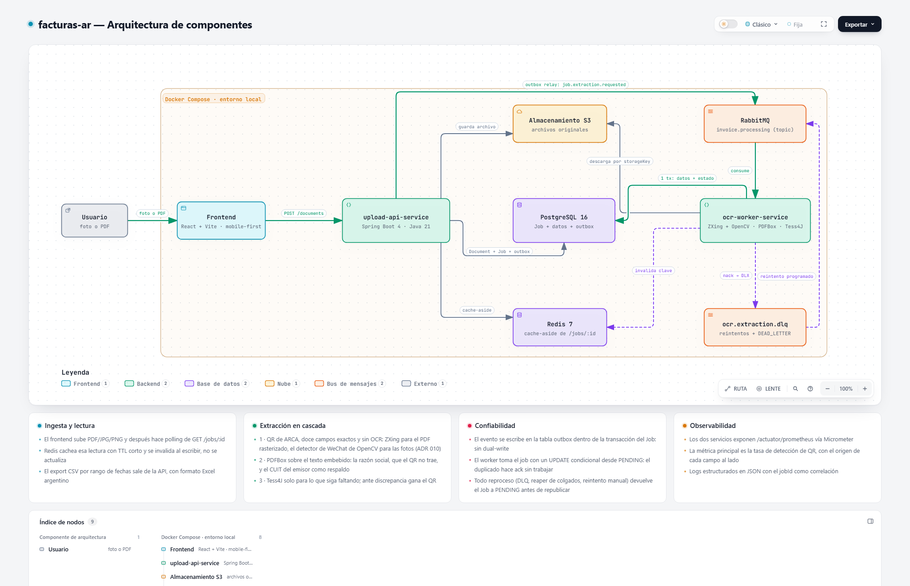
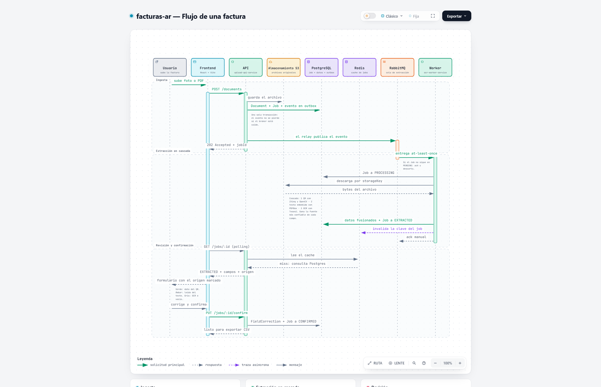

# facturas-ar — Documentación de Proyecto

> Extracción automática de datos de comprobantes fiscales argentinos (AFIP/ARCA): de una foto o un PDF a CSV.
>
> Backend developer junior (Java/Spring Boot) — proyecto de portfolio #3, enfocado en mensajería asíncrona, caching y observabilidad.

**Documentos de este repo:**

| Documento | Qué contiene |
|---|---|
| Este README | Qué se construye: alcance, arquitectura, esquema, stack, roadmap |
| [Análisis de dominio y diseño](docs/analisis-dominio-y-diseno.md) | Por qué el problema es así: perfiles de usuario, competencia, glosario fiscal, casos de uso detallados, patrones justificados y descartados |
| [Decisiones de arquitectura](docs/adr/) | Los diez ADRs: por qué cada cosa es así y no de otra forma, con las alternativas que se descartaron |

---

## Estado actual

**Fase 1, semanas 1-3 y el export de la 5. Fase 2 y Fase 3 completas.** El sistema ingesta un comprobante, le extrae los
datos, y devuelve el período en un CSV que abre en Excel sin tocar nada.
**La extracción no pasa en el request y no pasa en el mismo proceso**:
entre la subida y el procesamiento hay una fila durable en
`outbox_event`, un RabbitMQ y **un segundo deployable**. El `POST`
responde en medio segundo; si el worker se cae a mitad de un job, el job
vuelve solo; y todo eso se mide en Prometheus.

| | |
|---|---|
| ✅ **Funciona hoy** | Subida de PDF/JPG/PNG, almacenamiento S3-compatible, lectura del QR, deduplicación en tres capas, razón social desde el texto del PDF, confirmación, **export CSV por rango de fechas**, **transactional outbox con su relay**, **RabbitMQ con ack manual, DLQ y su consumidor**, **reaper de jobs colgados**, **worker como servicio aparte**, **cache-aside en Redis invalidado por el worker**, **métricas custom en Prometheus con dashboard de Grafana**, **logs JSON correlacionados entre los dos servicios**, **autenticación real con sesión en cookie y CSRF**, **revisión con correcciones por campo auditadas**, **frontend React con cámara que lee el QR en vivo, formulario de revisión, historial y export**, stack dockerizado, 423 tests (401 de backend —84 contra Postgres, RabbitMQ y Redis reales— y 22 de frontend), CI |
| ⬜ **Falta** | **OCR de respaldo** para comprobantes sin QR (Tess4J + OpenCV), que es la mitad de la Fase 1 que queda. Y volver a medir el criterio 2 ahora que hay cámara: el 85% sigue sin reponerse |

**La API hoy:** `POST /auth/register` · `POST /auth/login` ·
`POST /auth/logout` · `GET /auth/me` · `POST /documents` · `GET /jobs` ·
`GET /jobs/:id` · `PUT /jobs/:id/confirm` (con correcciones, o sin cuerpo) ·
`GET /export/csv?from=&to=`. Todo menos `register` y `login` necesita
sesión.

**Y hay pantalla:** <http://localhost:8081> con el stack arriba. El
navegador ve **un solo origen** — nginx sirve la SPA y proxea la API —
porque la cookie de sesión es `SameSite=Lax` y un navegador no la manda
entre orígenes distintos. Por qué eso no es un detalle de deploy, en el
[ADR 017](docs/adr/017-el-frontend-va-en-el-mismo-origen.md).

Lo que el resto de este documento describe es la **arquitectura final**,
no el estado de avance. El roadmap de la [sección 11](#11-roadmap-y-estimación-de-tiempo)
marca qué está hecho.

> **Medido contra comprobantes reales, no contra fixtures.** Un PDF con
> QR entrega los 12 campos; **ninguna de ocho fotos de celular entregó
> datos**, cuatro de ellas primeros planos. Eso tiró abajo un criterio de
> aceptación y movió la detección del QR al navegador. La medición está
> en la [sección 6](#cobertura-medida-sobre-comprobantes-reales) y la
> decisión en el [ADR 009](docs/adr/009-deteccion-del-qr-en-el-cliente.md).

> **Autenticación real, con sesión del lado del servidor.** Email y
> contraseña con BCrypt, la sesión en una cookie `HttpOnly` y el token de
> CSRF manejado en vez de desactivado. No un JWT, y el motivo no es moda:
> con sesión el logout corta el acceso en el instante, y la
> statelessness del token no compra nada con un solo proceso de API. Ver
> [ADR 015](docs/adr/015-sesion-con-cookie-y-no-un-token.md).
>
> Esto es lo que hizo testeable el **criterio de aceptación 7**. Antes
> había un sustituto que atribuía todo request al mismo usuario sembrado:
> las consultas filtraban por `user_id` desde el día 1, pero con un solo
> usuario posible cualquier par de "usuarios" era el mismo usuario y el
> filtro nunca se ejercitó.

> **Son dos procesos.** `upload-api-service` atiende HTTP, publica y
> recupera; `ocr-worker-service` consume la cola y corre la cascada. No
> comparten una línea de código propio: lo único en común son tres
> módulos `shared-*` y la base. Por qué no son microservicios, en el
> [ADR 006](docs/adr/006-dos-servicios-una-base.md); qué comparten y por
> qué, en el [ADR 013](docs/adr/013-los-repositorios-son-compartidos.md).

> **Probado con el broker caído.** Un `POST` con RabbitMQ detenido
> devuelve `202` igual: el evento espera en la tabla y sale cuando el
> broker vuelve. La medición está en el
> [ADR 005](docs/adr/005-transactional-outbox.md).

---

## 0. Arranque rápido

Requisitos: Docker y nada más. El JDK y Maven solo hacen falta si vas a
tocar el código — la imagen compila adentro con el wrapper versionado.

```bash
docker compose up -d --wait
```

Levanta los ocho servicios —Postgres, almacenamiento S3-compatible,
RabbitMQ, Redis, la API, el worker, Prometheus y Grafana— en ese orden,
esperando a que cada uno esté sano. Después:

| Qué | Dónde |
|---|---|
| API | http://localhost:8080 |
| Estado del servicio | http://localhost:8080/actuator/health |
| Métricas | http://localhost:8080/actuator/prometheus |
| Postgres | `localhost:5433`, base/usuario/clave `facturas` |
| **La aplicación** | http://localhost:8081 — la SPA, con la API proxeada en el mismo origen |
| Almacenamiento S3 | http://localhost:9090 |
| **Consola de RabbitMQ** | http://localhost:15672 — `facturas`/`facturas` |
| **Prometheus** | http://localhost:9091 — el `9090` lo usa S3Mock |
| Redis | `localhost:6379` |
| **Grafana** | http://localhost:3000 — abre directo en el dashboard, sin login |

> **Postgres va en el 5433 a propósito.** El 5432 suele estar ocupado por
> una instalación nativa, y con los dos escuchando la aplicación se
> conecta a la base equivocada y falla con un error de autenticación que
> no dice nada de todo esto.

### Probarlo

**Lo más rápido es abrir <http://localhost:8081>**: registrarse, subir un
PDF o usar la cámara, revisar los campos y confirmar. Lo que sigue es el
mismo recorrido con `curl`, que es lo que el frontend hace por debajo.

Primero hay que tener sesión. Son tres pasos y el primero sorprende: un
`GET` público, que es lo que entrega la cookie de CSRF.

```bash
# 1. Un GET cualquiera, solo para que el servidor mande XSRF-TOKEN.
curl -sc cookies.txt localhost:8080/actuator/health > /dev/null
CSRF=$(awk '/XSRF-TOKEN/ {print $7}' cookies.txt)

AUTH=(-b cookies.txt -c cookies.txt -H "X-XSRF-TOKEN: $CSRF")
JSON=(-H 'Content-Type: application/json')
CRED='{"email":"yo@ejemplo.ar","password":"unaClaveLarga"}'

# 2. Registrarse. No inicia sesión: son dos cosas, cada una con su paso.
curl "${AUTH[@]}" "${JSON[@]}" -d "$CRED" localhost:8080/auth/register
# 201 Created  (409 si el email ya está tomado)

# 3. Iniciar sesión. Acá queda la cookie de sesión en cookies.txt.
curl "${AUTH[@]}" "${JSON[@]}" -d "$CRED" localhost:8080/auth/login
# 200 OK  {"id":"7da6effe-...","email":"yo@ejemplo.ar"}
```

Sin el `X-XSRF-TOKEN` el `POST` responde **403**, incluso con sesión
válida: estar logueado es justo la situación de la que depende un ataque
CSRF. Y un `GET` a un endpoint protegido sin sesión responde **401**.

Ya con sesión:

```bash
curl "${AUTH[@]}" -F "file=@factura.pdf;type=application/pdf" \
     localhost:8080/documents
# 202 Accepted  {"jobId":"863f24b4-...","status":"PENDING","duplicate":false}

# La extracción corre del otro lado de la cola, así que el POST vuelve
# antes de que termine. Un GET inmediato muestra PENDING o PROCESSING:
curl -b cookies.txt localhost:8080/jobs/863f24b4-...
```

```json
{
  "status": "EXTRACTED",  "qrDetected": true,  "sourceType": "PDF_TEXT",
  "confidence": 0.992,
  "fields": {
    "issuerCuit": "30-71234567-1",  "invoiceTypeCode": 6,
    "pointOfSale": 3,               "invoiceNumber": 1201,
    "issueDate": "2026-03-02",      "total": 18450.00,
    "cae": 70417054367476,
    "issuerBusinessName": "PANADERIA LA ESPIGA S.A.",
    "sources": {
      "total": "QR", "cae": "QR", "issuer_cuit": "QR",
      "issuer_business_name": "PDF_TEXT"
    }
  }
}
```

Cada campo viene con su **fuente**: así el formulario de revisión sabe
cuál dato es oficial y cuál hay que mirar con cuidado.

Subir el mismo archivo otra vez devuelve `200` con el job que ya tenías.
Subir la misma factura en un archivo distinto devuelve `202`, y el job
queda en `DUPLICATE` apuntando al original — son dos barreras distintas,
explicadas en el [ADR 008](docs/adr/008-deduplicacion-en-tres-capas.md).

Confirmado el comprobante, entra al historial exportable. Sin cuerpo,
confirmar dice una sola cosa — *miré esto y está bien*:

```bash
curl "${AUTH[@]}" -X PUT localhost:8080/jobs/863f24b4-.../confirm
# 200 OK, el job queda en CONFIRMED
# 409 si todavía no terminó de extraerse: el pedido está bien, el job no está listo
```

Y con cuerpo, dice además qué estaba mal. Esto es lo que va a mandar el
formulario de revisión:

```bash
curl "${AUTH[@]}" "${JSON[@]}" -X PUT \
     -d '{"fields":{"issuerBusinessName":"PANADERÍA LA ESPIGA S.A.",
                    "total":"18450.00",
                    "cae":null}}' \
     localhost:8080/jobs/863f24b4-.../confirm
```

Tres cosas de ese pedido valen la explicación, y están en el
[ADR 016](docs/adr/016-el-servidor-calcula-el-diff-de-la-revision.md):

| | |
|---|---|
| El cliente manda **valores, no cambios** | Quién decide qué cuenta como corrección es el servidor, comparando contra la base. Así `original_value` no se puede falsificar, y un formulario que reenvía los nueve campos registra solo los que difieren |
| Es un **mapa** y no un record con nueve campos nullables | Clave ausente = dejalo como está. Clave con `null` = vacialo. Con un record, `null` tendría que significar las dos cosas |
| Los valores van como **string** | Es lo que guarda la tabla de auditoría, y obliga a que cada campo pase por su propio parseo: un CUIT con el dígito verificador mal se rechaza con **400** y un mensaje que lo dice |

Un campo corregido deja de decir que vino del QR: pasa a `source: USER`.
El cartelito de "esto es dato oficial" tiene que dejar de aparecer en un
campo que el usuario escribió a mano.

```bash
curl -b cookies.txt -OJ "localhost:8080/export/csv?from=2026-03-01&to=2026-03-31"
# comprobantes-2026-03-01-a-2026-03-31.csv
```

```csv
fecha;tipo_codigo;tipo;punto_venta;numero;cuit_emisor;razon_social;moneda;cotizacion;total;cae
02/03/2026;6;Factura B;3;1201;30-71234567-1;PANADERÍA LA ESPIGA S.A.;PES;1;18450,00;70417054367476
15/03/2026;8;Nota de Crédito B;3;1202;30-71234567-1;PANADERÍA LA ESPIGA S.A.;PES;1;-2100,00;70417054367478
```

El historial es otro endpoint, y filtra por **otra fecha**:

```bash
curl -b cookies.txt "localhost:8080/jobs?from=2026-11-01&to=2026-11-30&page=0&size=20"
# {"jobs":[{"jobId":"…","status":"CONFIRMED","total":25300.50,
#           "invoiceType":"Factura B","issuerBusinessName":"…"}],
#  "page":0,"size":20,"total":1}
```

Por **fecha de carga**, no de emisión, y eso es deliberado: un historial
filtrado por fecha de emisión esconde justo lo que alguien lo abre para
buscar — los jobs que fallaron, y los que no decodificaron el QR y por eso
no tienen fecha de emisión en absoluto. El export es la pregunta opuesta.
Devuelve una fila por **documento** y no por job, porque un comprobante
reprocesado aparecería dos veces y eso se lee como "se subió dos veces".

Solo salen al export los comprobantes **confirmados**, y por **fecha de
emisión**, no de carga: una factura de marzo subida en mayo pertenece a
marzo. La
nota de crédito sale en negativo, que es lo que hace que el total del
período cierre. El resto de las reglas del archivo está en la
[sección 7](#export).

### Para desarrollar

Lo habitual es levantar solo la infraestructura y correr los dos
servicios desde el IDE:

```bash
docker compose up -d postgres s3 rabbitmq redis
./mvnw spring-boot:run -pl upload-api-service    # 8080
./mvnw spring-boot:run -pl ocr-worker-service    # 8081, en otra terminal
```

Con la API sola alcanza para trabajar en la subida o el export: el
comprobante se queda en `PENDING` porque nadie consume la cola, y eso es
exactamente lo que el sistema hace cuando el worker está caído. Para ver
un job llegar a `EXTRACTED` hacen falta los dos.

> **El jar ejecutable lleva sufijo:** `upload-api-service-…-boot.jar`, no
> el que no tiene ninguno. Es por la dependencia de test del worker a la
> API — ver el [ADR 013](docs/adr/013-los-repositorios-son-compartidos.md).
> `spring-boot:run` no se entera; `java -jar` sí.

Y para correr los tests hace falta **Docker corriendo**: levantan
Postgres, RabbitMQ y Redis de verdad con Testcontainers.

Y para empezar de cero, incluida la base:

```bash
docker compose down -v
```

## 1. Visión y objetivo

El usuario sube una factura (PDF o foto), el sistema extrae automáticamente los datos relevantes (proveedor, CUIT, fecha, tipo y número de comprobante, CAE, neto, IVA, total) y permite exportar a CSV o PDF prolijo. Resuelve un problema tedioso real (carga manual de datos) para freelancers, monotributistas y cualquiera que junta tickets/facturas.

**Ventaja de nicho:** foco en facturas argentinas (AFIP/ARCA), que son bastante estandarizadas — ventaja competitiva frente a herramientas genéricas en inglés. Más concreto todavía: desde 2021 **toda factura electrónica argentina lleva un código QR obligatorio** ([RG 4892/2020](https://www.afip.gob.ar/fe/qr/documentos/QRespecificaciones.pdf)) que codifica los datos del comprobante en JSON. Eso convierte al OCR en el último recurso en vez del motor del sistema — ver [sección 6](#6-extracción-de-datos).

**Por qué este proyecto:** los dos proyectos anteriores del portfolio ya demuestran profundidad backend (hexagonal/DDD, JWT/RBAC, auditoría de seguridad, 108 tests, CI/CD). Este proyecto cubre lo que falta — mensajería asíncrona, caching (Redis) y observabilidad — de forma justificada por el problema de negocio, no "pegada con cinta".

**Objetivo del proyecto:** sumar un tercer proyecto sólido al portfolio que demuestre mensajería asíncrona, caching y observabilidad de forma justificada por un problema real — no conseguir usuarios ni construir un producto. Compartirlo con algunas personas reales (ver sección 2) es una validación opcional que mejora la narrativa del portfolio, no un objetivo en sí mismo.

### Por qué no alcanza con "Mis Comprobantes" de ARCA

ARCA ya ofrece gratis un servicio donde cualquier contribuyente con clave fiscal ve sus comprobantes emitidos y recibidos, filtra por período (hasta 365 días) y los exporta a CSV. Vale enfrentar la comparación de frente, porque es la primera objeción razonable al proyecto:

| Limitación de Mis Comprobantes | Qué cubre este proyecto |
|---|---|
| Solo aparece lo que se emitió **a tu CUIT** | Las facturas B a consumidor final, tickets de combustible, gastos de viaje y compras en comercios chicos no están ahí |
| No están los comprobantes no electrónicos | Tickets fiscales viejos, comprobantes manuales, papel |
| Datos incompletos: comprobantes con percepciones y montos en moneda extranjera vienen mal | La extracción lee el comprobante real |
| **No hay API**: la única vía es entrar al portal y descargar a mano | Ingesta por upload, sin clave fiscal de por medio |
| Te da la fila, no el archivo | El PDF o la foto queda pegado al dato, recuperable para una auditoría |

> En una frase: *Mis Comprobantes cubre lo que ARCA ya sabe de vos; esto cubre la pila de papel y PDFs que ARCA no sabe, y te deja el archivo original junto al dato.*

---

## 2. Validación opcional: prueba informal con un par de personas

El orden técnico del roadmap (sync → cola/Redis → observabilidad → pulido) es el camino principal del proyecto y no depende de esto.

**Sugerencia opcional, no bloqueante:** al terminar la Fase 1 (ver sección 10), si hay tiempo y ganas, mostrar el sistema funcionando (sync) a 2-3 personas (podés usar tus propias facturas o pedirle a algún conocido monotributista que pruebe). No es un lanzamiento ni requiere esfuerzo de difusión en comunidades — el objetivo es simplemente juntar un puñado de casos reales de fotos de celular (mala luz, ángulo torcido, formatos de ticket distintos) que vos solo no vas a generar con datos de prueba propios. Si sale, suma como dato concreto para el README ("probado con N facturas reales, X% de precisión en campos clave"); si no hay tiempo, no afecta el avance del proyecto — se puede seguir directamente a la Fase 2 con datos de prueba generados por vos.

---

## 3. Alcance del MVP (v1)

### Decisión de auth
**Auth simple (email/password, sin roles ni RBAC)** + historial + export por rango de fechas. El RBAC ya está demostrado en otro proyecto del portfolio, no hace falta repetir profundidad ahí.

Decidido el alcance, lo único que quedaba era **cómo viaja la
credencial**: sesión del lado del servidor en una cookie `HttpOnly`, no un
JWT. Con sesión el logout corta el acceso en el instante en que se pide,
la cookie es inalcanzable desde JavaScript, y no hay biblioteca ni
secreto de firma que mantener. Lo que el token vende —no compartir
estado— no compra nada con un solo proceso de API, y el día que haya
varios, Spring Session sobre Redis es una dependencia que este stack ya
tiene. El costo es CSRF, que se maneja y no se apaga. Ver
[ADR 015](docs/adr/015-sesion-con-cookie-y-no-un-token.md).

### Incluido en v1

| Área | Alcance |
|---|---|
| **Perfil objetivo** | **Monotributista**, registrando los comprobantes que recibe. Decidido — ver [análisis de dominio §1.2](docs/analisis-dominio-y-diseno.md). El responsable inscripto queda para v2: necesita IVA por alícuota y percepciones, que es todo lo que el QR no trae |
| Ingesta | Subida de PDF o foto (JPG/PNG) desde web, responsive (mobile-first, porque la gente saca fotos desde el celular) |
| Extracción | **Del QR (exactos):** CUIT emisor, tipo de comprobante, punto de venta, número, fecha de emisión, importe total, moneda, cotización, documento del receptor, CAE. **Del texto/OCR:** razón social del emisor — y nada más |
| Revisión | Formulario editable con los campos extraídos antes de confirmar, **marcando el origen de cada campo** (QR, texto embebido u OCR). Los que vienen del QR son solo lectura por defecto — *por defecto es una decisión del formulario, no del endpoint: el servidor los acepta igual, porque el criterio 3 pide poder completar a mano un comprobante sin QR*. La API ya está ([ADR 016](docs/adr/016-el-servidor-calcula-el-diff-de-la-revision.md)); falta la pantalla |
| Historial | Lista de facturas cargadas por usuario, con estado y filtro por fecha |
| Export | CSV de un lote (rango de fechas) y PDF prolijo de una factura individual |
| Confiabilidad | Reintentos automáticos en el worker; si falla definitivamente, reintento manual o recarga |
| Auth | Simple, solo para separar datos por usuario |

### Explícitamente fuera de scope v1

- **Ítems de línea** (detalle producto por producto) — complejidad de parseo de tablas no justificada; totales alcanzan para el 90% del caso de uso contable.
- **Neto gravado, IVA e IVA discriminado por alícuota**, y **percepciones** de IVA/IIBB — son los campos que necesita un responsable inscripto para el Libro IVA Digital, y justo los que el QR no trae. Un monotributista no toma crédito fiscal, así que no le sirven; además, en los comprobantes que recibe muchas veces **ni siquiera existen** (la factura C no lleva IVA y la B lo lleva incluido sin discriminar). Las columnas quedan en el esquema preparadas para v2, pero v1 no las extrae ni las pide. v2.
- Validación del CAE contra ARCA (webservice de constatación) — es barata ahora que el QR entrega el CAE, pero requiere certificado y clave fiscal: fricción de setup. v1.1, con buenas chances de adelantarse.
- Carga por lote (ZIP con múltiples archivos) — v1.1.
- Ingesta por mail (reenviar factura a una casilla) — v2, buen gancho de retención pero necesita infra de mail entrante.
- Multi-tenant / equipos / compartir con contador — v2.
- Modelo de ML propio — se arranca con reglas; el dataset de correcciones (`FieldCorrection`) se guarda desde el día 1 para habilitar esto a futuro.

### Criterios de aceptación del MVP

1. **PDF de factura electrónica con QR legible → los 12 campos del QR correctos, en el 100% de los casos** de un set de al menos 20 comprobantes reales variados. No es un umbral optimista: el QR es un dato estructurado, o se lee o no se lee.
2. **Foto de celular:** el QR se detecta **en el navegador, antes de subir**, y la foto se acepta solo si decodificó. Criterio verificable en lugar de un porcentaje: no hay foto aceptada sin QR leído. *(🔶 **Construido, sin medir.** La cámara lee en vivo con `BarcodeDetector` y `jsQR` de respaldo, y el obturador espera al QR. Pero el obturador espera **solo en la cámara**: el selector de archivos no, porque el criterio 3 pide que un comprobante sin QR entre igual — ver [ADR 017](docs/adr/017-el-frontend-va-en-el-mismo-origen.md). Cuántas fotos reales decodifican en el navegador **no está medido**, y hasta que lo esté este criterio no se declara cumplido: es justo el error que el [ADR 009](docs/adr/009-deteccion-del-qr-en-el-cliente.md) cometió una vez.)*
3. Comprobante **sin** QR → degrada a texto/OCR sin romperse; el usuario puede completar a mano. *(🔶 La mitad del servidor está: verificado contra el stack real subiendo un PDF sin QR, completando ocho campos a mano y obteniendo una línea CSV válida de un comprobante del que la cascada no leyó nada. El OCR de respaldo y la pantalla siguen pendientes.)*
4. Usuario puede corregir cualquier campo y confirmar; cada corrección queda registrada. *(✅ **Cumplido en la API**, falta la pantalla. `field_corrections` llevaba **cero filas desde la primera migración** —una apuesta del día 1— y ahora se escribe en cada revisión, con el valor viejo leído de la base y no declarado por el cliente. El campo corregido además deja de decir que vino del QR. Ver [ADR 016](docs/adr/016-el-servidor-calcula-el-diff-de-la-revision.md).)*
5. El archivo original siempre es recuperable, sin importar cómo haya salido la extracción. Un archivo ilegible o que no es una factura **no es un fallo del sistema**: el formulario sale vacío y el documento queda guardado igual.
6. Export CSV de un rango de fechas que abre en Excel y Sheets con montos como números y acentos correctos, **sin intervención manual**. *(✅ **Cumplido en los dos**, verificado abriendo el archivo. La vuelta por Excel encontró algo que ningún test podía: el CAE salía como `7,04171E+13`.)*
7. Un usuario no puede acceder a datos de otro — con test automatizado que lo demuestre. *(✅ **Cumplido.** El test registra dos usuarios por HTTP, cada uno con su sesión; uno sube un comprobante y el otro pide ese job y recibe **404**, no 403 — un 403 confirmaría que existe. No se podía testear antes: el sustituto de autenticación atribuía todo request al mismo usuario. Ver [`AuthPostgresTest`](upload-api-service/src/test/java/ar/facturas/upload/adapters/in/rest/AuthPostgresTest.java).)*
8. El sistema sobrevive a que el worker se caiga a mitad de un procesamiento: el mensaje se reprocesa y el resultado no se duplica. *(✅ **Cumplido.** "No se duplica" lo da el claim atómico desde la Fase 1: una reentrega encuentra el job no tomable y no hace nada. "Se reprocesa" faltaba hasta el reaper — un worker que moría entre el claim y el ack dejaba el job en `PROCESSING`, que no es un estado procesable, así que nadie lo levantaba nunca. Ver [sección 8](#el-reaper-los-jobs-que-ninguna-cola-va-a-mover).)*
9. Siempre hay feedback visible de estado ("procesando"), aunque la Fase 1 sea síncrona.

> **El criterio (2) decía "≥ 85% de las fotos" y se cayó al medirlo.**
> Primero contra el lector que había, que leyó 0 de 8 fotos. Después
> contra otros tres decodificadores, y ahí el diagnóstico cambió: el
> detector de QR de OpenCV lee 4 de 6 de las mismas fotos donde ZXing
> leía 1. El cuello no era la foto, era el lector. La historia completa
> está en [cobertura medida](#cobertura-medida-sobre-comprobantes-reales);
> las decisiones, en el [ADR 009](docs/adr/009-deteccion-del-qr-en-el-cliente.md)
> y su corrección, el [ADR 010](docs/adr/010-dos-motores-para-leer-el-qr.md).
> El 85% **no vuelve** hasta que haya una muestra que lo sostenga.

---

## 4. Arquitectura general

Los diagramas se generan con [Archify](https://github.com/tt-a1i/archify) a partir del JSON tipado que vive en [docs/diagrams/](docs/diagrams/). Cada uno se publica como un HTML interactivo (temas claro/oscuro, foco por nodo, trazado de rutas, export a imagen). Abajo va la vista estática, porque GitHub no renderiza el HTML del repo: para la versión navegable, abrí el archivo después de clonar.

### Vista de componentes

> Esto ya es el estado real, **incluido el frontend** desde que entró la semana 4. Lo único del diagrama que todavía no existe es el OCR de respaldo dentro del worker.
> Todo lo demás —los dos servicios, la cola, el outbox, el
> almacenamiento, Redis, Prometheus— está corriendo.

<picture>
  <source media="(prefers-color-scheme: dark)" srcset="docs/diagrams/arquitectura-dark.png">
  
</picture>

**[Abrir diagrama interactivo](docs/diagrams/arquitectura.html)** · fuente: [arquitectura.architecture.json](docs/diagrams/arquitectura.architecture.json)

### Responsabilidades por componente

| Componente | Responsabilidad | Qué **no** hace |
|---|---|---|
| `frontend` | Upload, encuadre de la foto, polling de estado, formulario de revisión, historial y export | Nada de OCR ni reglas de parseo |
| `upload-api-service` | Auth, persistencia de `Document`/`Job`, subida al storage, escritura del evento en la tabla outbox, **el relay que lo publica**, **la recuperación de fallas** (reaper y consumidor de la DLQ), lectura cacheada, export CSV/PDF | No extrae nada: **ya no tiene ZXing, OpenCV ni PDFBox en el classpath** |
| `ocr-worker-service` | Consume la cola y corre la **cascada de extracción** (QR → texto embebido → OCR), fusiona por confianza, persiste resultado e invalida cache | No conoce al usuario (el evento no lleva `userId`) |
| `RabbitMQ` | Desacople y buffer entre ingesta y procesamiento, reintentos y dead-letter | No transporta el archivo (solo el `storageKey`) |
| `Redis` | Cache-aside de `GET /jobs/:id` (polling intensivo del frontend). **La API lee, el worker invalida** | No es fuente de verdad: se invalida, no se actualiza. Y no es obligatorio: si no está, la API responde desde Postgres |
| Almacenamiento S3 | Guarda los archivos originales. S3Mock en desarrollo, cualquier backend S3-compatible en producción | — |
| `Prometheus` + `Grafana` | Scrapeo de métricas de ambos servicios y dashboards | — |

### Flujo de una factura, de punta a punta

<picture>
  <source media="(prefers-color-scheme: dark)" srcset="docs/diagrams/flujo-factura-dark.png">
  
</picture>

**[Abrir diagrama interactivo](docs/diagrams/flujo-factura.html)** · fuente: [flujo-factura.sequence.json](docs/diagrams/flujo-factura.sequence.json)

> **Hoy:** falta Redis y falta el worker como servicio aparte. Todo lo demás de este diagrama está: la subida escribe el evento en `outbox_event` en su propia transacción, el relay lo publica a **RabbitMQ**, y un `@RabbitListener` con ack manual corre la cascada — en otro hilo, después de que el `POST` ya respondió. El consumidor está escrito como consumidor de cola, así que mudarlo a `ocr-worker-service` no cambia su cuerpo. Ver sección 11 (Roadmap).

### Regenerar los diagramas

Archify no es dependencia del proyecto: se edita el JSON y se vuelve a renderizar.

```bash
# instalar el skill para el agente (una vez)
npx skills add tt-a1i/archify -g

# o usar el CLI directo desde un clon del repo de Archify
node <ruta>/archify/bin/archify.mjs finalize architecture \
  docs/diagrams/arquitectura.architecture.json docs/diagrams/arquitectura.html --quality showcase
```

Las vistas estáticas (`*-light.png` / `*-dark.png`) salen de `archify visual-check <html> --out-dir <dir>`.

Sin Archify a mano, esas PNG salen igual del HTML ya renderizado: son una
captura de la página entera, así que Chrome headless alcanza.

```bash
chrome --headless=new --hide-scrollbars --force-prefers-reduced-motion \
  --window-size=2048,1320 --force-device-scale-factor=1 \
  --screenshot=docs/diagrams/arquitectura-light.png \
  "file:///<ruta absoluta>/docs/diagrams/arquitectura.html?theme=light"
```

---

## 5. Esquema de datos

### Diagrama de entidades

```
User
 └─< Document (1:N)
       └─< Job (1:N)            -- 1:N para permitir reprocesar sin resubir archivo
             ├─1:1 ExtractedInvoiceData
             └─<  FieldCorrection (1:N)

OutboxEvent                      -- tabla suelta, sin FK: su vida es más corta que la del Job
```

### `User`
```
id (uuid)
email
password_hash
created_at
```

### `Document`
```
id (uuid)
user_id (FK)
original_filename
storage_key          -- clave opaca en el almacenamiento S3
mime_type
file_size_bytes
content_hash          -- sha256, deduplication ("you already uploaded this invoice")
source_type            -- PDF_TEXT | PDF_SCANNED | IMAGE
qr_detected            -- boolean; métrica de primera clase del pipeline
uploaded_at
```

### `Job`
```
id (uuid)
document_id (FK)
status                 -- see states table
retry_count
max_retries             -- e.g. 3
error_message           -- nullable, only if FAILED/DEAD_LETTER
ocr_engine              -- "tesseract-5.3", to compare engines in the future
overall_confidence      -- 0-1, aggregated score
duplicate_of_job_id     -- nullable, FK a jobs; obligatorio si status=DUPLICATE
created_at
started_at              -- nullable
completed_at            -- nullable
```

**Estados del Job:**

| Estado | ¿Procesable? | Significado |
|---|---|---|
| `PENDING` | **sí** | Encolado, esperando worker. **El único estado desde el que se puede empezar a trabajar** |
| `PROCESSING` | no | Un worker lo tiene tomado. Si llega otro mensaje para este job, es un duplicado |
| `EXTRACTED` | no | La extracción terminó, listo para revisión del usuario (no hay estado separado de "baja confianza": el formulario siempre es editable) |
| `CONFIRMED` | no | Usuario revisó/corrigió y aprobó — entra al historial exportable |
| `DUPLICATE` | no | El comprobante ya estaba cargado por este usuario. `duplicate_of_job_id` apunta al original. El archivo se conserva; lo que no se duplica es el dato extraído |
| `FAILED` | no | El último intento falló por un error recuperable (timeout, error transitorio). Estado de reposo: **espera a que el reintentador lo devuelva a `PENDING`**, no se procesa desde acá |
| `DEAD_LETTER` | no | Agotó reintentos o archivo irrecuperable — requiere acción manual del usuario |

**Transiciones válidas:**

```
PENDING ──claim──> PROCESSING ──> EXTRACTED ──> CONFIRMED
                        │
                        ├── ya cargado por este usuario ──> DUPLICATE
                        │
                        ├── error recuperable ──> FAILED ──┐
                        │                                   │
                        └── colgado (reaper) ───────────────┤
                                                            │
                        retry_count < max_retries ──────────┴──> PENDING
                        retry_count >= max_retries ─────────────> DEAD_LETTER

                        DEAD_LETTER ──reintento manual del usuario──> PENDING
```

> **Hay una sola puerta de entrada al trabajo: `PENDING`.** El reintento del DLQ, el reaper de jobs colgados y el botón de reintento manual hacen todos lo mismo — devolver el job a `PENDING` y republicar. Esto es lo que hace que la idempotencia sea una regla de una línea en vez de una lista de casos especiales.

### `ExtractedInvoiceData` (1:1 con Job)
```
job_id (FK, PK)
user_id                     -- denormalizado desde documents.user_id (ver abajo)

-- Campos que vienen del QR (exactos cuando hay QR legible)
issuer_cuit                 -- bigint, con dígito verificador validado
invoice_type_code           -- int, código de la tabla oficial de ARCA (1=Fact A, 6=B, 11=C...)
point_of_sale               -- int, hasta 5 dígitos
invoice_number              -- int, hasta 8 dígitos
issue_date                  -- date
total                       -- numeric(15,2)
currency                    -- varchar(3), "PES" | "DOL" | ...
exchange_rate               -- numeric(19,6), cotización a pesos (1 si es ARS)
recipient_doc_type          -- int (80=CUIT, 86=CUIL, 96=DNI, 99=sin identificar)
recipient_doc_number        -- numeric(20)
cae                         -- bigint, código de autorización
auth_code_type              -- varchar(1), "E"=CAE | "A"=CAEA

-- Campos que el QR NO trae: salen del texto embebido o del OCR
issuer_business_name
net_amount                  -- numeric(15,2), neto gravado
vat_amount                  -- numeric(15,2), IVA total (sin discriminar por alícuota en v1)
recipient_vat_condition     -- REGISTERED_TAXPAYER | MONOTRIBUTO | FINAL_CONSUMER | ...

-- Trazabilidad de la extracción
qr_payload_raw              -- jsonb, el JSON crudo decodificado del QR
raw_ocr_text                -- texto completo del OCR o del PDF, para reparsear sin reprocesar
field_sources               -- jsonb, {"total": "QR", "issuer_business_name": "OCR", ...}
field_confidence            -- jsonb, {"issuer_cuit": 1.0, "net_amount": 0.60, ...}
```

> **Todos los montos en `NUMERIC`, nunca `float`/`double`/`REAL`.** El QR especifica el importe con hasta 13 enteros y 2 decimales, y la cotización con hasta 6 decimales.
>
> **Nada de `CHAR(n)`.** Postgres lo desaconseja: rellena con espacios y tiene semántica de comparación propia, sin ventaja a cambio. Y los identificadores que entran holgados en un `long` (CUIT, CAE) van en `BIGINT` y no en `NUMERIC`.
>
> `qr_payload_raw` y `raw_ocr_text` permiten reparsear jobs históricos si se mejoran las reglas, sin volver a correr Tesseract (la parte cara).
>
> `field_sources` es lo que habilita el indicador visual del formulario de revisión: el usuario ve de dónde salió cada dato.

**Índices obligatorios:**

```sql
-- En documents: misma ARCHIVO, mismo usuario. Atrapa el doble clic.
UNIQUE (user_id, content_hash)

-- En extracted_invoice_data: mismo COMPROBANTE, mismo usuario.
-- Parcial, para que las extracciones fallidas (todo NULL) no choquen entre sí.
UNIQUE (user_id, issuer_cuit, invoice_type_code, point_of_sale, invoice_number)
   WHERE issuer_cuit IS NOT NULL AND invoice_type_code IS NOT NULL
     AND point_of_sale IS NOT NULL AND invoice_number IS NOT NULL

INDEX (user_id, issue_date)        -- historial y export, sin joins
INDEX (status) WHERE status IN ('PENDING','PROCESSING')   -- claim atómico
```

**Por qué `user_id` está denormalizado en `extracted_invoice_data`:** por dos motivos independientes. Es la única forma de expresar *"este comprobante ya lo cargó este usuario"* como restricción de base, y el export filtra por usuario y fecha — sin la columna hay que joinear `jobs` y `documents` solo para saber de quién es la fila. Es además la clase segura de denormalización: el dueño de un documento no cambia nunca.

**Por qué el hash del archivo no alcanza:** atrapa el doble clic, no la duplicación real. Se escapan dos casos frecuentes — tener el PDF del mail *y* la foto del impreso (dos archivos, mismo comprobante), y volver a descargar la factura del portal del proveedor cuando el PDF regenerado difiere en un byte de metadata. La identidad fiscal `(CUIT, tipo, punto de venta, número)` sí los atrapa, y **el QR nos la da exacta**: tenemos una clave de deduplicación confiable justamente por haber puesto el QR primero.

**Por qué por usuario y no global:** dos personas pueden cargar el mismo comprobante legítimamente — una pareja con la factura de luz, dos socios con la del proveedor.

> La detección va en la aplicación: consulta antes de insertar y marca el `Job` como `DUPLICATE` con un mensaje útil (*"ya cargaste este comprobante el 3 de marzo"*), no con un error de constraint. El índice único es la red de seguridad contra la carrera de dos subidas simultáneas — ahí se captura la violación y se convierte en `DUPLICATE` igual.

### `OutboxEvent`
```
id (uuid)                  -- es también el eventId que viaja en el mensaje
aggregate_id               -- el jobId. Sin FK: el outbox no debe poder
                           --   bloquear la escritura de lo que lo genera
event_type                 -- "job.extraction.requested"
event_version              -- viaja en la fila, no hardcodeado en el relay
payload                    -- jsonb
created_at                 -- cuándo PASÓ el hecho, no cuándo se publicó
published_at               -- nullable; null = pendiente de publicar
```

> Se escribe en la **misma transacción** que el `Job`. Un relay la vacía contra el transporte. Ver [sección 8](#publicación-transactional-outbox).
>
> `id` es el `eventId` del mensaje, y eso es lo que hace **reconocible una reentrega**: se asigna una sola vez, al escribir la fila, y no cambia por más veces que el relay la publique. La diferencia entre `published_at` y `created_at` es la latencia que introduce el outbox — la métrica que dice si el relay está sano.
>
> El índice es **parcial** (`WHERE published_at IS NULL`). En una tabla que solo acumula, es la diferencia entre un índice que crece para siempre y uno que mide lo que queda sin publicar, o sea casi siempre vacío. Las filas publicadas se quedan como auditoría; la poda va con las métricas de la Fase 3, porque cuánto retener no se decide sin medir.

### `FieldCorrection` (1:N con Job)
```
id
job_id (FK)
field_name
original_value       -- what the OCR produced
corrected_value       -- what the user entered
corrected_at
```

> Dataset base para: (1) métrica de qué campo falla más, (2) futuro entrenamiento de modelo si se abandona el approach de reglas.

> **Se escribe desde la revisión.** Estuvo con cero filas desde la
> primera migración hasta acá, y eso era la apuesta: el dataset que dice
> qué regla de parseo anda peor no se puede juntar después, porque para
> entonces las correcciones ya se tiraron.
>
> `original_value` lo lee el servidor de la base, no lo declara el
> cliente — si no, la tabla sería un registro de lo que el cliente dice
> que pasó. Es append-only: una corrección es algo que ocurrió, así que
> editarla sería reescribir la historia, que es justamente el valor de la
> tabla. Ver [ADR 016](docs/adr/016-el-servidor-calcula-el-diff-de-la-revision.md).

---

## 6. Extracción de datos

### El dato que define el diseño: el QR obligatorio

Desde 2021 ([RG 4892/2020](http://biblioteca.afip.gob.ar/dcp/REAG01004892_2020_12_22)) toda factura electrónica argentina lleva un código QR. **No es un link a un sitio de consulta:** codifica los datos del comprobante en JSON, en Base64, dentro de la URL.

```
https://www.arca.gob.ar/fe/qr/?p={JSON en Base64}
```

```json
{"ver":1,"fecha":"2020-10-13","cuit":30000000007,"ptoVta":10,"tipoCmp":1,
 "nroCmp":94,"importe":12100,"moneda":"DOL","ctz":65,"tipoDocRec":80,
 "nroDocRec":20000000001,"tipoCodAut":"E","codAut":70417054367476}
```

Eso significa que **los campos más críticos del MVP no necesitan OCR**: salen exactos, sin ambigüedad y sin score de confianza inventado. Lo único que el QR no trae y v1 sí necesita es la **razón social**, y en un PDF con texto la resuelve PDFBox sin OCR. El OCR queda para los comprobantes sin texto embebido.

> **[ADR 004 — QR primero, OCR de último recurso](docs/adr/004-qr-primero-ocr-de-respaldo.md).** La decisión técnica más importante del proyecto, con las dos diferencias que aparecieron entre la especificación de ARCA y lo que ARCA realmente emite.

### Cascada de tres estrategias

El worker corre las estrategias en orden de prioridad y **cada campo se queda con el valor de la fuente más confiable que lo haya producido**.

| # | Estrategia | Librería | Confianza | Qué aporta |
|---|---|---|---|---|
| 1 | **QR** | ZXing + OpenCV | 1.0 | fecha, CUIT, punto de venta, tipo, número, importe, moneda, cotización, doc. receptor, CAE |
| 2 | **Texto embebido** | Apache PDFBox | 0.9 | razón social y CUIT del emisor — solo si el PDF trae texto |
| 3 | **OCR** | OpenCV + Tess4J | 0.3 – 0.8 | lo que siga faltando, en fotos y PDFs escaneados |

```java
public interface ExtractionStrategy {
    boolean supports(SourceType sourceType);
    ExtractionResult extract(DocumentContent content);
    int priority();          // QR=100, PDF_TEXT=50, OCR=10
}

public record ExtractedField<T>(T value, double confidence, FieldSource source) {}
```

Agregar una estrategia nueva (PaddleOCR en v2, por ejemplo) no toca el orquestador: es una clase más y una línea de registro.

### Clasificación del origen

`PDFTextStripper` devuelve >50 caracteres → `PDF_TEXT`. Vacío o casi vacío → `PDF_SCANNED`. Imagen → `IMAGE`. Esto decide qué estrategias se corren, no si hay QR: **el QR se busca siempre**, rasterizando la primera página con `PDFRenderer` cuando es PDF.

### Detección del QR

- **Dos motores, probados en orden** ([ADR 010](docs/adr/010-dos-motores-para-leer-el-qr.md)): ZXing (`com.google.zxing:core` + `javase`) para el PDF rasterizado y el escaneo limpio, y el detector de QR que WeChat aportó a OpenCV para las fotos.
- **Sin probar rotaciones.** El QR lleva tres patrones de posición justamente para que el lector deduzca la orientación; girar la imagen cuatro veces sería cuadruplicar el trabajo para resolver algo que el formato ya resuelve. Hay un test que lo fija.
- Si hay QR pero el Base64 no decodifica o el JSON no valida contra el schema v1 → se ignora y se sigue por texto/OCR, registrando la anomalía (puede ser un QR falso).
- **El preprocesamiento de imagen cambia de objetivo:** el deskew y la binarización ahora sirven, en primer lugar, para que ZXing encuentre el código. Que además ayuden a Tesseract es un beneficio secundario.

### Cobertura medida sobre comprobantes reales

El criterio de aceptación original apostaba a detectar el QR en el **85%
de las fotos de celular**. Nadie lo había medido. Al medirlo salieron dos
conclusiones, y la primera estaba mal.

**Primera medición, con el lector que había** (ZXing, `TRY_HARDER` y los
dos binarizadores):

| Comprobante | Formato | Resultado |
|---|---|---|
| Factura B, vendedor de Mercado Libre | **PDF** | ✅ los 12 campos del QR |
| Factura A de proveedor (×2 fotos) | foto | ❌ sin QR encontrado |
| Comercio local (foto + primer plano) | foto | ❌ sin QR encontrado |
| Comercio local (×2 fotos) | foto | ❌ sin QR encontrado |
| Comercio local (foto + primer plano) | foto | ⚠️ QR leído, **payload vacío** |
| Factura de luz (foto + primer plano del QR) | foto | ⚠️ sin QR de ARCA (el suyo es de pago) |

**Un PDF entrega el 100% de los campos. Ocho fotos entregaron cero** —
incluidos cuatro primeros planos sacados apuntando al código.

De ahí salió el diagnóstico de que el problema era la **densidad**: el QR
de ARCA codifica ~268 caracteres y necesita una matriz de 69×69 módulos,
que impresa en dos centímetros de papel térmico no deja píxeles por
módulo suficientes. Y que el preprocesamiento no lo arregla, porque el
deskew y la binarización recuperan contraste, no información que la
cámara nunca captó.

Todo eso es cierto salvo la conclusión que le colgué: que entonces no
quedaba nada por hacer en el servidor. Eso se había medido con **un solo
decodificador**.

**Segunda medición, contra cuatro decodificadores**, sobre las tres
facturas que seguían accesibles (en 1200×1600, ya redimensionadas en el
camino, o sea peores que el original de la cámara):

| Comprobante | ZXing | OpenCV `QRCodeDetector` | `QRCodeDetectorAruco` | **WeChat** |
|---|---|---|---|---|
| A, página | ❌ | ❌ | ❌ | ❌ |
| A, primer plano | ❌ | ❌ | ❌ | ❌ |
| B, página | ❌ | ❌ | ❌ | ⚠️ payload vacío |
| B, primer plano | ⚠️ payload vacío | ❌ | ❌ | ⚠️ payload vacío |
| C, página | ❌ | ❌ | ❌ | ✅ **13 campos** |
| C, primer plano | ❌ | ✅ | ✅ (a 2×) | ✅ **13 campos** |
| **total** | **1 de 6** | 1 de 6 | 1 de 6 | **4 de 6** |

**ZXing leyó uno, y es el del payload vacío: cero datos utilizables.
WeChat leyó cuatro, dos con el payload ARCA completo.** La foto de página
de C decodificó a **1,87 píxeles por módulo** — por debajo del piso que
yo había dado por insuperable. El payload recuperado pasó por nuestro
`ArcaQrDecoder` sin una queja y coincide con lo impreso en el papel: el
parser nunca estuvo roto, el eslabón flojo era el lector de imagen.

Las dos de A no las lee nadie, pero no por densidad: el primer plano
tiene el código grande y nítido, con los módulos chorreados unos sobre
otros y bandas blancas horizontales de una impresora gastada. Catorce
variantes de preprocesado, ningún detector, nada.

Dos hallazgos más, de los que solo aparecen con papel real:

- **Hay emisores que imprimen el QR sin payload.** Un comercio local
  emite `https://www.arca.gob.ar/fe/qr/?p=` y nada más — 33 caracteres.
  Ese comprobante no se puede constatar desde su propio código. Es un bug
  del emisor; el decodificador lo reporta como `Malformed` con un mensaje
  propio, y es la primera vez que un dato real ejercita esa rama.
- **No todo comprobante lleva QR de ARCA.** La factura de luz y un cupón
  de pago llevan QR, pero de pago. El decodificador los descarta sin
  ruido y sigue por la estrategia siguiente, que es justo lo que tiene
  que hacer.

> **La consecuencia inmediata: se cambió el lector.** El QR pasa por dos
> motores — ZXing para el PDF rasterizado, el detector de WeChat de
> OpenCV para las fotos. Ver [ADR 010](docs/adr/010-dos-motores-para-leer-el-qr.md).
>
> **La detección en el cliente sigue en pie, con menos peso.** El
> navegador decodificando cuadro a cuadro sirve para que el usuario
> corrija el encuadre con la respuesta delante, en vez de enterarse
> después de subir. Pero ya no es lo único que separa al producto de no
> funcionar, así que es una mejora de UX y no justifica mover trabajo de
> fase. Lo que no cambia: el servidor no le cree al cliente. Lo que manda
> el browser entra por el mismo validador y, si el servidor no pudo
> corroborarlo contra la imagen, queda `QR_CLIENT` con confianza 0.95 en
> vez de 1.0. Ver [ADR 009](docs/adr/009-deteccion-del-qr-en-el-cliente.md).
>
> **Y el OCR no era la respuesta a esto.** El papel borroso que no deja
> leer el QR tampoco deja leer el texto. El OCR queda para lo que siempre
> fue: comprobantes sin QR y la razón social.

### Preprocesamiento de imagen

Con OpenCV (`org.bytedeco:opencv`, el mismo artefacto que trae el detector de QR):

1. **Escala de grises**
2. **Corrección de deskew** (transformada de Hough) — el paso de mayor impacto en fotos reales de celular
3. **Binarización adaptativa** (Gaussian) — crítico con luz despareja o sombras
4. **Eliminación de ruido** (median blur leve antes de binarizar)
5. **Detección/recorte de bordes del documento** — *diferido a v1.1*; en v1, guía visual de encuadre en el frontend

Tesseract con `--psm 6` (bloque uniforme de texto) como modo inicial.

> OpenCV pasa de ser crítico a secundario: si da problemas de portabilidad, **no bloquea el MVP**.

### Parseo de campos sobre texto (reglas + regex)

Componente compartido entre la estrategia de texto embebido y la de OCR — recibe texto plano, no sabe de dónde salió. **No duplicar estas reglas entre estrategias:** es la parte del código que más va a cambiar.

- **`issuer_business_name`:** heurística de posición en las primeras líneas del bloque del emisor.
- **`net_amount` / `vat_amount`:** etiquetas ("Subtotal", "Neto", "IVA") + regex de montos en formato argentino (`$ 1.234,56`). **v2** — v1 no los extrae, ver el perfil de usuario objetivo.
- **`recipient_vat_condition`:** match contra el vocabulario fijo de AFIP ("Responsable Inscripto", "Consumidor Final", "Monotributo"...).
- **`issuer_cuit` / `issue_date` / `total`:** reglas de respaldo, solo usadas si no hubo QR.

### Verificación cruzada

Como se tienen los valores de **todas** las fuentes y no solo el ganador, la confianza se puede calcular en vez de inventar:

- ¿El total del QR coincide con el leído por OCR? → refuerza ambos.
- ¿`neto + IVA ≈ total`? → refuerza.
- ¿El **dígito verificador del CUIT** cierra? → refuerza.
- Discrepancia → **gana el QR**, y se registra.

### Validación y corrección del CUIT

El último dígito de un CUIT es verificador (módulo 11), lo que da validación y corrección asistida gratis:

```
pesos  = [5,4,3,2,7,6,5,4,3,2]   // sobre los primeros 10 dígitos
suma   = Σ digito[i] * pesos[i]
dv     = 11 - (suma % 11)
si dv == 11 → dv = 0
si dv == 10 → dv = 9
```

Si el OCR leyó 11 dígitos y el verificador no cierra, se prueban las confusiones típicas (`8↔3`, `5↔6`, `1↔7`, `0↔O`): si una sola combinación valida, la probabilidad de acierto es alta.

> Esto vive en un **value object `Cuit`** que no se puede instanciar inválido.

### Códigos de tipo de comprobante

El QR devuelve `tipoCmp` como código numérico de la [tabla oficial de ARCA](https://www.afip.gob.ar/fe/documentos/TABLACOMPROBANTES.xls). El subconjunto relevante:

| Código | Comprobante | Signo |
|---|---|---|
| 1 / 2 / 3 | Factura A / Nota de Débito A / **Nota de Crédito A** | + / + / **−** |
| 6 / 7 / 8 | Factura B / ND B / **NC B** | + / + / **−** |
| 11 / 12 / 13 | Factura C / ND C / **NC C** | + / + / **−** |
| 19 | Factura E (exportación) | + |
| 51 | Factura M | + |
| 81 / 82 / 111 | Tique Factura A / B / C | + |
| 201 / 206 / 211 | FCE MiPyME A / B / C | + |

> **Las notas de crédito restan.** El signo va en el enum `TipoComprobante`, no en un `if` perdido en el servicio de export.

---

## 7. Stack técnico

### Upload/API Service
- Java 21 (LTS) + Spring Boot 4.1.1
- Maven, con wrapper (`mvnw`) versionado: no hace falta tener Maven instalado para compilar
- Spring Data JPA + PostgreSQL 16
- Flyway (migraciones)
- Almacenamiento de objetos S3-compatible vía SDK `software.amazon.awssdk:s3`. En desarrollo corre **Adobe S3Mock**; ver la nota al pie de esta sección
- Spring AMQP (`spring-boot-starter-amqp`)
- Bean Validation
- springdoc-openapi (Swagger UI)

### Cola de mensajes
- RabbitMQ 3.13.x — **en uso** ([sección 8](#8-contratos-de-eventos))
- Exchange tipo `topic`, declarado por la aplicación con `RabbitAdmin`
- Dead-letter exchange nativo de RabbitMQ
- Confirmaciones del publisher (`publisher-confirm-type: simple`): el relay no marca un evento publicado hasta que el broker lo confirma
- El envelope viaja en las propiedades de AMQP, no dentro del body ([ADR 011](docs/adr/011-el-envelope-viaja-en-las-propiedades-de-amqp.md))

### Worker de extracción
- Java 21 + Spring Boot 4.1.1 — **deployable aparte, en uso** ([ADR 006](docs/adr/006-dos-servicios-una-base.md))
- **ZXing** (`com.google.zxing:core` + `com.google.zxing:javase`) — lectura del QR en PDF rasterizado y escaneos
- **OpenCV** (`org.bytedeco:opencv`, compilado con `opencv_contrib`) — el detector de QR de WeChat, que es el que lee las fotos, más el preprocesamiento del OCR. **Juntas, la dependencia más importante del proyecto** ([ADR 010](docs/adr/010-dos-motores-para-leer-el-qr.md))
- Apache PDFBox 3.x — texto embebido (`PDFTextStripper`) y rasterizado de la página para buscar el QR (`PDFRenderer`)
- Jackson — parseo del JSON del QR (ya viene con Spring Boot)
- Tess4J 5.x (Tesseract 5.3+ en el contenedor: `tesseract-ocr tesseract-ocr-spa`) — estrategia de último recurso
- Parseo de texto: regex + Java puro, sin librería
- `@RabbitListener` con `acknowledge-mode: manual` y `prefetch: 1`, ackeando después del commit ([ADR 012](docs/adr/012-una-extraccion-fallida-se-ackea.md))

### Redis
- Redis 7.x, Spring Data Redis (Lettuce) — **en uso**
- Cache-aside en `GET /jobs/{id}`, TTL 30s, invalidación por **delete** on-write
- Sin persistencia (`--save "" --appendonly no`): un cache que sobrevive al reinicio puede devolver algo de antes de un deploy
- **Entró último a propósito.** Cachear un read no tiene nada interesante; lo interesante es que la API sirve la respuesta cacheada y **el worker es el que la hace incorrecta**, porque el worker es el que termina el job. Con los dos en un proceso la invalidación sería un `Map.remove` y no demostraría nada
- **La clave lleva el dueño** (`job:{userId}:{jobId}`), y eso no es prolijidad: `GET /jobs/{id}` responde 404 para un job ajeno, y esa verificación corre contra la fila de la base — que un hit del cache se saltea. Con la clave sin el usuario, el polling de uno llenaría una entrada que se le serviría a otro, y una optimización de performance se habría vuelto un bypass de autorización
- **Degrada, no falla.** Un miss y un error son lo mismo para el endpoint, así que la API sigue respondiendo desde Postgres mientras Redis reinicia. El costo es una invalidación que falla y deja una respuesta vieja: el TTL es la garantía de último recurso, igual que el barrido detrás del camino rápido del relay y el reaper detrás de la cola

> **Medido contra el stack real**, deteniendo el worker para poder ver
> los dos pasos por separado: con el worker caído, un `GET` deja una
> clave `job:{userId}:{jobId}` en Redis con TTL 30 s, y una segunda
> lectura sigue diciendo `PENDING` porque sale del cache. Al levantar el
> worker, **borra esa entrada desde el otro proceso** y el endpoint
> empieza a decir `EXTRACTED` sin que nadie se lo pida. Ver
> [ADR 014](docs/adr/014-el-cache-se-invalida-y-la-clave-lleva-el-dueno.md).

### Testing
- JUnit 5 + AssertJ
- **Testcontainers** — Postgres, RabbitMQ y el almacenamiento de objetos reales en los tests de integración. Para un proyecto cuyo argumento es "sé manejar infraestructura asíncrona", testear contra H2 y mocks contradice el argumento
- Set de comprobantes reales versionado como fixtures de la cascada de extracción

**En uso desde el export.** `ExportQueryTest` levanta un Postgres 16
—la misma imagen del `docker-compose.yml`— corre las migraciones de
Flyway y arranca la aplicación entera, controllers incluidos, porque la
consulta del export decide qué filas entran a un archivo contable: eso
lo resuelve SQL, no un mock. Las pruebas de HTTP piden el CSV por el
puerto real — y desde que hay autenticación **se registran e inician
sesión primero**, igual que un cliente, que es lo que hace honesto el
nombre de la clase: *through the whole application*.

`OutboxPostgresTest` es el segundo, y todo lo que prueba es algo que
contra mocks no se puede probar, porque en los tres casos el que trabaja
es Postgres: que el `Job` y su evento sean **una sola escritura** es una
propiedad de la transacción; que dos relays simultáneos se **repartan**
los eventos en vez de duplicarlos lo decide el lock, y hacen falta dos
conexiones sosteniéndolo a la vez para verlo; y que un evento abandonado
se publique **después** solo es cierto si la fila sobrevivió a un commit.

`RecoveryPostgresTest` es el que cierra el **criterio de aceptación 8**,
y tiene que estar acá porque las dos mitades son propiedades de la
infraestructura: *"no se duplica"* es el `UPDATE` condicional que corre
la base, y *"se reprocesa"* es una fila que el reaper encuentra y un
mensaje que el broker después entrega. Los cutoffs del reaper se le pasan
por parámetro en vez de leerlos de la config, así los tests piden "todo,
sin importar la antigüedad" en lugar de envejecer filas o esperar un
reloj.

`RabbitMessagingTest` es el cuarto, y corre contra un RabbitMQ real por
el mismo motivo: un `RabbitTemplate` mockeado le da la razón a lo que el
test espera. Lo que está en duda es qué cruza el cable (el body se
compara a nivel de `byte[]` contra lo que guardó el outbox), dónde
termina un mensaje que el consumidor rechaza, y que uno que no reconoce
no bloquee nada. Inspecciona los mensajes por una **segunda cola**
bindeada al mismo exchange y routing key: un exchange topic entrega a
todos los bindings que matchean, así que el test mira sin interferir —
la otra opción era parar el listener, y un test que lo deja parado
cuando falla rompe los que vienen después.

`AuthPostgresTest` es el último, y es el que no se puede bajar de HTTP sin
perderlo todo: la sesión vive en una cookie, el token de CSRF en otra
cookie más un header, y la cadena de filtros es lo que los conecta — un
test que llamara al controller directamente estaría afirmando algo sobre
una llamada a método y pasaría con toda la cadena mal configurada. No es
hipotético: así se colaron dos bugs reales, y los encontró este test al
pasar por el puerto ([ADR 015](docs/adr/015-sesion-con-cookie-y-no-un-token.md)).
Acá vive el **criterio de aceptación 7**: dos usuarios registrados de
verdad, cada uno con su sesión, y uno pidiendo el job del otro.

`HistoryPostgresTest` cubre el endpoint del historial, y tres de sus diez
casos son propiedades que solo SQL puede resolver: que un comprobante
reprocesado aparezca **una vez** (un documento tiene muchos jobs, y sin la
subconsulta la lista lo muestra dos veces, que se lee como "se subió dos
veces"); que un job **fallido** siga en la lista (no tiene fila en
`extracted_invoice_data`, y un join interno descartaría justo las filas
que alguien abre un historial para encontrar); y el **criterio 7** otra
vez, que en un endpoint de lista es donde más fácil se olvida — no hay un
id que chequear, así que lo único que separa a dos usuarios es el
`WHERE`.

Consecuencia práctica: **`./mvnw test` necesita Docker corriendo.** Los
tres contenedores —Postgres, RabbitMQ y Redis— arrancan una sola vez por
JVM y Ryuk los limpia al terminar.

**El frontend tiene 22 tests, y cubren dos cosas.** `npm test`, con vitest
y jsdom, sin Docker.

El *wrapper* de `fetch`, porque el baile del CSRF **es invisible cuando se
rompe**: toda escritura contesta 403 —o 401 en un endpoint público— y nada
en la pantalla dice por qué. Esa confusión ya costó una sesión del lado de
la API ([ADR 015](docs/adr/015-sesion-con-cookie-y-no-un-token.md)) y las
dos veces era una cookie que faltaba. Los tests fijan que un `GET` no
manda token, que un `POST` sin cookie hace primero el `GET` que la emite,
que el token se lee fresco en cada request —cachearlo manda uno viejo
después del próximo login— y que el `detail` del `ProblemDetail` se
conserva, que es lo único accionable de un error.

Y el formulario de revisión: que los nueve campos estén, que las insignias
de origen se muestren (ocho `QR` y una `texto` en un comprobante con QR,
nueve `vacío` en uno sin), que el candado del QR no se invierta, que
"editar" desbloquee **uno** y no todos, y que se manden los nueve campos
aunque no se haya tocado ninguno — que es la forma que el
[ADR 016](docs/adr/016-el-servidor-calcula-el-diff-de-la-revision.md)
necesita.

El resto de los componentes los cubre el `tsc -b` del build, que es poco
pero no es nada: es lo que se rompe cuando la API cambia un campo y el
frontend sigue leyéndolo.

> **Lo que no está testeado, y conviene decirlo:** que la pantalla se vea
> bien. Eso se mira abriendo <http://localhost:8081>. Un test de
> componentes verifica que el formulario tenga nueve inputs; no verifica
> que quepan en un teléfono.

### Export
- CSV: Apache Commons CSV o OpenCSV (nunca a mano con StringBuilder)
- PDF: Apache PDFBox (Apache 2.0 — evitar iText, es AGPL/comercial)

**Formato del CSV — los detalles que arruinan el archivo si se ignoran:**

| Regla | Por qué |
|---|---|
| Separador `;` | Excel en configuración regional argentina lee `,` como decimal: con comas, todo cae en una sola columna |
| UTF-8 **con BOM** | Sin BOM, Excel rompe acentos y eñes |
| Decimales con coma (`12100,50`) | Para que Excel lo reconozca como número y sea sumable |
| Fechas `dd/mm/yyyy` | Estándar AFIP |
| Notas de crédito en negativo | Si no, el total del período está mal |
| Columnas `cae` y `tipo_codigo` (código numérico) | Lo hace importable a software contable. Al lado va `tipo` con la descripción: el código para la máquina, el texto para quien abre el archivo |

> Probarlo con Excel real, no solo con Sheets. Un export que el usuario tiene que arreglar a mano es exactamente el problema que el proyecto dice resolver.

**Implementado**, con Apache Commons CSV. Tres decisiones que no estaban
en la especificación y aparecieron al escribirlo:

| Caso | Qué hace | Por qué |
|---|---|---|
| Un `tipo_codigo` fuera de los que modelamos | Exporta el importe **sin signo**, no vacío | `getSignedTotal()` devuelve vacío tanto cuando no hay importe como cuando no se puede decidir el signo. Tratar los dos igual dejaría una fila con total vacío: el comprobante estaría en el archivo y no contaría. Sin signo está bien para todo salvo una nota de crédito, y `tipo_codigo` queda en el archivo para que el caso se vea |
| El `cae`, que son 14 dígitos | **Tabulador adelante**, para que sea texto | Como número, Excel lo muestra `7,04171E+13`. El valor sobrevive —14 dígitos entran en los 15 de precisión— pero el usuario no puede leer el único campo que abriría el archivo para chequear. Nadie suma esta columna, así que ser número no aporta nada y cuesta eso |
| Una razón social que empieza con `=`, `+`, `-` o `@` | Tabulador adelante | La planilla ejecuta esa celda como fórmula al abrir el archivo. Es la vía por la que un CSV se convierte en una forma de correr algo en la máquina de quien lo descarga |

**Sobre el tabulador, que no era la primera opción.** El consejo habitual
es un apóstrofe adelante. **No funciona:** Excel honra el `'` cuando
alguien tipea en una celda, no cuando parsea un CSV, así que queda
visible en el archivo. Entrecomillar tampoco hace nada — las comillas son
sintaxis CSV y se sacan antes de decidir el tipo. La tercera opción,
`="70417054367476"`, sí anda y se descartó por dos razones: es una
fórmula, y le pone `="70417054367476"` adelante a cualquier software
contable, que es la única razón por la que esa columna existe. El
tabulador deja los dígitos detrás de un espacio que un `trim()` saca.

Las cuatro se probaron abriendo el archivo en un Excel real, que es el
único lugar donde se pueden probar.

**En Google Sheets el tabulador no hace falta, y tampoco molesta.** Sheets
muestra un entero de 14 dígitos completo, no usa notación científica como
Excel, así que el CAE se lee bien con tabulador o sin él. Necesario en
uno, inofensivo en el otro: es el mejor caso posible para esa decisión.

> **El criterio de aceptación está cumplido y verificado a mano, en Excel
> y en Google Sheets.** El archivo abre con los importes como números
> sumables, las notas de crédito en negativo, los acentos y eñes
> correctos, la razón social con punto y coma en una sola celda y el CAE
> legible, sin tocar nada. La suma de la columna `total` del archivo de
> muestra da `29870,75`, que es el chequeo más barato de que los importes
> entraron como números **y** de que la nota de crédito entró en negativo.
>
> Los tests cubren que los bytes lleven lo que una planilla necesita; que
> la planilla efectivamente lo haga es una verificación manual, y se
> repite si cambia el formato.

> **Un detalle de Sheets que no es del archivo.** Sheets parsea según el
> idioma del documento, no el del sistema, y su diálogo de importación
> tiene una opción **"Convertir texto en números, fechas y fórmulas"**.
> Con esa opción apagada entra todo como texto —hasta un `6` suelto— y
> parece que el formato está roto cuando no lo está. Con el idioma en
> Estados Unidos, `18450,00` no es un número y `02/03/2026` es el 3 de
> febrero. Las dos cosas se configuran antes de importar.

### Observabilidad

Micrometer (Spring Boot Actuator) + `micrometer-registry-prometheus`,
scrapeado por **Prometheus 2.54** desde `/actuator/prometheus` en los dos
servicios, y **un dashboard de Grafana 11 provisionado desde el
repositorio**.

> **Ni el datasource ni los paneles se configuran por la consola.** Lo
> que se configura clickeando se pierde al recrear el contenedor y no
> queda versionado — es el mismo motivo por el que la topología de
> RabbitMQ la declara la aplicación y no un script. `allowUiUpdates:
> false`: el dashboard vive en el repositorio o no vive.

**El tablero habla del problema, no de la máquina.** No hay un solo panel
de CPU. Lo que se mira es: si los comprobantes entregan su QR, si los
eventos salen, cuánto tarda una extracción, qué hace la recuperación
cuando algo falla, y de dónde sale cada campo.

**Las métricas que publica hoy.** Todas contestan una pregunta que
alguien tiene de verdad; los nombres y los tags viven en un solo archivo
([`PipelineMetrics`](upload-api-service/src/main/java/ar/facturas/upload/application/metrics/PipelineMetrics.java))
porque un nombre tipeado dos veces es una serie que se parte en silencio.

| Métrica | Qué pregunta contesta |
|---|---|
| `invoice.qr.detection` (Counter, tags `source`, `document`) | **la más importante del sistema**: qué proporción de comprobantes entrega su QR, y por qué tipo de documento |
| `invoice.extraction.source` (Counter, tags `field`, `source`) | qué proporción de cada campo viene del QR, del texto o del OCR — dice dónde invertir esfuerzo |
| `invoice.job.processing.time` (Timer con histograma, tag `outcome`) | cuánto tarda una extracción. **Es el número del que tiene que salir el timeout del reaper** |
| `invoice.outbox.publish.latency` (Timer con histograma) | el hueco entre que el evento pasó y que salió: si el relay está sano |
| `invoice.outbox.pending` (Gauge) | cuántos eventos esperan. Sostenido arriba de cero = el transporte está mal |
| `invoice.recovery.moves` (Counter, tag `outcome`) | qué está haciendo el reaper: `requeued`, `dead_lettered`, `republished` |
| `invoice.deadletter.received` (Counter, tag `resolution`) | qué llega a la DLQ, y si se pudo rastrear a un job |
| `invoice.job.duplicate.delivery` (Counter) | con qué frecuencia el at-least-once realmente muerde. **Un cero constante significaría que la idempotencia nunca se ejercitó** |

> **Dos de estos nombres cambiaron respecto de lo que esta sección
> publicaba, y por qué.**
>
> Decía `invoice.qr.detection.rate` con un tag booleano `detected`. Un
> counter **no es un rate** — el rate lo calcula la consulta, y la
> convención de Prometheus es que el nombre de un counter sea un total —
> así que el `.rate` se fue. Y el tag es `source` en vez de `detected`
> porque es lo que pide el [ADR 009](docs/adr/009-deteccion-del-qr-en-el-cliente.md)
> y lleva estrictamente más información: quién leyó el QR, con `detected`
> todavía derivable como `source != "ninguno"`.
>
> Y decía `invoice.job.processing.time` con tag `strategy`, con la idea
> de "el QR en milisegundos, el OCR en segundos". Ese tag **no mapea**
> contra lo que el timer mide: el timer envuelve la cascada entera, y una
> cascada puede usar varias estrategias para un mismo documento, así que
> no hay una sola a la que atribuirle el tiempo. El tag es `outcome`, que
> además es lo que hace al timer usable para elegir el cutoff del reaper
> —una falla rápida no puede arrastrar la distribución de las
> extracciones que sí funcionan.
>
> `invoice.job.outcome` como counter aparte no está: un timer ya publica
> un `_count` por valor de tag, así que
> `invoice_job_processing_time_seconds_count{outcome="failed"}` es el
> mismo número sin un segundo medidor que mantener sincronizado.

**Los nombres salen traducidos**, y así hay que consultarlos: los puntos
se vuelven guiones bajos, un counter gana `_total`, y un timer se vuelve
una familia `_seconds_count` / `_seconds_sum` / `_seconds_bucket`. Nada
en el código Java lo dice, así que
[`PipelineMetricsPostgresTest`](upload-api-service/src/test/java/ar/facturas/upload/application/metrics/PipelineMetricsPostgresTest.java)
lo fija aserción contra el texto exacto que Prometheus recibe. Un nombre
de métrica es un contrato con un panel y con una alerta, y es un contrato
que se rompe en silencio: si lo renombrás, la consulta no falla —
devuelve vacío, que se ve igual que un sistema sano.

**`invoice.field.correction.rate` ya cuenta.** Entró con la revisión, y
es la métrica más directa del dashboard: el campo más alto es el que la
extracción se equivoca más seguido, o sea donde conviene gastar el
próximo día de trabajo en las reglas de parseo. Se incrementa una vez por
campo que **efectivamente cambió**, no por campo enviado — si no, mediría
cómo manda el formulario en vez de cómo anda la extracción.

**Lo que falta:** `invoice.ocr.confidence`, que necesita el OCR. Entra
con el código que la produce.

> **Un hallazgo del día que entró la revisión, y era peor que lo que
> estaba construyendo.** Probando el `curl` de arriba salió un 500 donde
> esperaba un 400, y tirando del hilo: **todo pedido mal formado de toda
> la API contestaba 500.** Un email inválido, una clave corta, un id que
> no es UUID, un export sin parámetros, un `DELETE` — todos. La causa era
> que `ApiExceptionHandler` reclamaba `Exception` como red de último
> recurso, y eso le gana a las excepciones propias de Spring MVC antes de
> que Spring pueda mapearlas. Las anotaciones `@Email` y `@Size` que
> escribí con la autenticación eran decorativas: puestas, nunca
> aplicadas, y nada falló para avisarlo. El detalle está en el
> [ADR 016](docs/adr/016-el-servidor-calcula-el-diff-de-la-revision.md).

> Un dashboard con "tasa de detección de QR" y "origen de cada campo" es mucho más interesante de mostrar que uno con uso de CPU: habla del problema, no de la máquina.

### Logs estructurados

En JSON, formato ECS (Elastic Common Schema).

> **Sin `logstash-logback-encoder`, que es lo que esta sección
> especificaba.** Spring Boot 4 lo trae nativo
> (`logging.structured.format.console`), así que la dependencia no hace
> falta. Una menos que mantener, por algo que ahora viene en la caja.

**El formato solo se activa adentro de los contenedores**
(`LOGGING_STRUCTURED_FORMAT_CONSOLE=ecs` en el compose). Corriendo el jar
a mano los logs quedan legibles para una persona, que es quien los lee en
ese caso.

**Lo que los hace servir para algo más que verse prolijos: el `eventId` y
el `jobId` en el MDC.** Con eso un pedido se sigue **desde la fila del
outbox hasta la extracción, cruzando los dos servicios**, sin un sistema
de tracing:

**Medido contra el stack**, filtrando por el **campo** `jobId` y no por
el texto del mensaje:

```
[upload-api-service]  event=-         Comprobante uploaded: job=1ebea4f9…
[upload-api-service]  event=-         Upload of job 1ebea4f9… committed; draining…
[upload-api-service]  event=ece2ab5f  Published job.extraction.requested v1
[ocr-worker-service]  event=ece2ab5f  Can't dereference COSObject{1 0 R}
[ocr-worker-service]  event=ece2ab5f  Can't dereference COSObject{1 0 R}
[ocr-worker-service]  event=ece2ab5f  Job 1ebea4f9… extracted: 0 fields, qr=false
```

Las dos primeras no tienen `eventId` porque todavía no existe: el evento
nace cuando el relay lo publica. Y las dos del medio **son de PDFBox** —
el MDC aplica a todo lo que se loguea en ese hilo, así que la queja de
una librería de terceros sale estampada con el comprobante que estaba
leyendo, sin que PDFBox sepa nada. Eso es la mitad del valor.

Es el **mismo id en los tres lugares**: la clave primaria de la fila del
outbox, el `message-id` del mensaje AMQP y la línea de log de los dos
servicios ([ADR 011](docs/adr/011-el-envelope-viaja-en-las-propiedades-de-amqp.md)).
No se diseñó para esto — igual que el truco del `message-id` para
rastrear un mensaje ilegible en la DLQ.

> El MDC se limpia **siempre** en un `finally`. Un hilo de listener se
> reusa del pool: una clave que queda colgada le estampa al mensaje
> siguiente el id del anterior, y eso es peor que no tener contexto.

**Micrometer Tracing + Zipkin** sigue siendo opcional. Con el `eventId`
correlacionando las dos puntas, lo que agregaría es el span y el timing
distribuido — útil, pero ya no es lo que falta para poder depurar.

### Frontend
- React + Vite + React Query, sin Redux (alcanza para el polling de estado, que es el único estado compartido que hay)
- **Sin router**, y con fecha de vencimiento: dos pestañas y una vista de detalle no justifican una dependencia. En el momento en que haya una pantalla que valga la pena linkear desde afuera, entra `react-router`
- Sin framework de CSS: la app son cinco pantallas y un formulario, y una librería de utilidades pesaría más que la app y pondría las decisiones de diseño en strings de clases
- **Detección del QR en vivo con la cámara**, antes de subir: [`BarcodeDetector`](https://developer.mozilla.org/en-US/docs/Web/API/BarcodeDetector) donde existe, `jsQR` de respaldo, y **se reporta cuál de los dos leyó** — una medición que no dice qué decodificador la produjo es la que se equivocó en el [ADR 009](docs/adr/009-deteccion-del-qr-en-el-cliente.md)
- Alternativa más rápida: Thymeleaf server-side dentro del Upload Service (descartada, mobile UX peor — y además la detección en vivo necesita `getUserMedia` y un bucle de decodificado en el cliente, que es una SPA con otro nombre)

**Lo que cuesta pensar del frontend no es React, es cómo se sirve.** La
cookie de sesión es `HttpOnly` y `SameSite=Lax`
([ADR 015](docs/adr/015-sesion-con-cookie-y-no-un-token.md)), y un
navegador **no manda una cookie `Lax` entre orígenes distintos** — esa es
justamente la regla que la hace valer. La única forma de evitarlo es
`SameSite=None; Secure`, que exige HTTPS y entonces no funciona en
`http://localhost` en absoluto.

Así que el navegador ve **un solo origen**: nginx sirve el bundle y proxea
`/auth`, `/documents`, `/jobs`, `/export` y `/actuator` a la API; el
servidor de Vite hace lo mismo en desarrollo con su `server.proxy`. Las
alternativas eran debilitar la cookie o cambiar a un token —deshacer el
ADR 015 para acomodar al servidor de desarrollo—. Y tiene una ventaja que
no es menor: **lo que se desarrolla es lo que se despliega**. Todo en el
[ADR 017](docs/adr/017-el-frontend-va-en-el-mismo-origen.md).

| Decisión del frontend | Por qué |
|---|---|
| **El obturador espera al QR, pero solo en la cámara** | Resuelve una tensión real entre el criterio 2 (la foto se acepta solo si decodificó) y el 3 (un comprobante sin QR entra igual). Con un teléfono sobre un papel, decir que el encuadre no sirve es la razón de estar ahí; un PDF sin QR no tiene ángulo que corregir. Hay escape igual —*"sacar la foto igual"*— porque el servidor lee mejor, con dos decodificadores |
| **Los campos del QR son de solo lectura por defecto** | Una tecla de más en un CAE es peor que un clic de más. Y *por defecto* es decisión del formulario, no del endpoint: la API los acepta igual, porque el criterio 3 lo necesita |
| **El formulario manda los nueve campos siempre** | Qué cuenta como corrección lo decide el servidor ([ADR 016](docs/adr/016-el-servidor-calcula-el-diff-de-la-revision.md)). Así el formulario no lleva la cuenta de lo que se tocó y no puede equivocarse |
| **Dos rangos de fecha en el historial** | La lista filtra por fecha de **carga** y el export por fecha de **emisión**, rotulados así. Una factura de marzo cargada en mayo pertenece a marzo en un archivo contable y a mayo en "qué hice hoy" |
| **La cámara se apaga de verdad** | Los *tracks* del stream se detienen al desmontar. Sin eso el teléfono sigue grabando con la luz prendida, que desde afuera se ve igual que spyware |

### Infraestructura local
- Docker Compose. Hoy levanta lo que el código usa: **Postgres 16**, **Adobe S3Mock**, **RabbitMQ 3.13** y la propia API. Redis, Prometheus y Grafana entran en las Fases 2 y 3.
- La imagen de RabbitMQ es la `-management`: la consola en el `15672` (`facturas`/`facturas`) es la mitad de cómo se depura una cola, y poder abrirla y ver el mensaje adentro vale los MB.
- La API se construye con un **Dockerfile multi-stage** que parte el jar en capas (`jarmode=tools extract --layers`). Importa: el jar pesa ~149 MB y copiarlo entero reescribía todo ante cualquier cambio; partido, la capa de código propio pesa 143 kB.
- GitHub Actions: `./mvnw verify` y build de la imagen en cada push y PR a main

> **Por qué S3Mock y no MinIO.** El plan original era MinIO, pero sus imágenes dejaron de ser públicas: tanto Docker Hub como quay.io piden login. La segunda opción, LocalStack, ahora exige `LOCALSTACK_AUTH_TOKEN` y sale con error sin él. S3Mock es Apache 2.0 y arranca sin credenciales ni registro.
>
> **El código no cambia:** va por el SDK de S3 igual, así que apuntar a S3 real, a MinIO o a cualquier otro backend es cambiar un endpoint. Esa es toda la razón por la que el almacenamiento está detrás de un puerto.

---

## 8. Contratos de eventos

### Exchange

```
invoice.processing (topic)
  └─ key job.extraction.requested ──► ocr.extraction.queue   (durable)
                                        │ nack, requeue=false
                                        ▼
invoice.processing.dlx (topic)
  └─ key job.extraction.failed ─────► ocr.extraction.dlq     (durable)
```

Config de la cola principal:
```
x-dead-letter-exchange: invoice.processing.dlx
x-dead-letter-routing-key: job.extraction.failed
```

**Declarada por la aplicación**, no a mano ni desde el compose: el
`RabbitAdmin` de Spring crea lo que falte en cada arranque, así que un
broker nuevo —otro entorno, un volumen borrado, un contenedor de
Testcontainers— levanta con la topología correcta y sin un paso de setup
que alguien pueda olvidar. Declarar es idempotente; declarar con
argumentos **distintos** no, y falla fuerte — que es el comportamiento
que conviene tener, porque es cómo se nota una cola cuya definición se
desvió.

**Topic para una sola routing key.** Un exchange directo haría lo mismo
hoy. El motivo es que la routing key *es* el tipo de evento: el día que
exista `job.extraction.completed`, un consumidor puede bindearse a
`job.extraction.*` sin que el publisher se entere de que existe. Es la
propiedad que hace que esto valga más que una llamada a un método, y hoy
no cuesta nada.

> Verificado contra el broker real:
> ```
> $ docker compose exec rabbitmq rabbitmqctl list_queues name durable messages arguments
> ocr.extraction.queue  true  0  [{"x-dead-letter-exchange","invoice.processing.dlx"},
>                                 {"x-dead-letter-routing-key","job.extraction.failed"}]
> ocr.extraction.dlq    true  0  []
> ```

### Evento: `job.extraction.requested`

Escrito por el Upload Service en la tabla `OutboxEvent`, en la misma transacción que crea el `Job` en `PENDING`. Un relay lo publica después (ver abajo).

**El payload es el body del mensaje, verbatim. El envelope va en las
propiedades que AMQP ya tiene para eso.**

```
routing key : job.extraction.requested
message-id  : 5ec68b31-7c33-4785-970d-32e7fe09d74c   ← el eventId
type        : job.extraction.requested
headers     : { eventVersion: 1 }
timestamp   : 2026-11-23T16:40:49.961Z               ← cuándo PASÓ
content-type: application/json
delivery-mode: 2 (persistent)

body:
{"jobId":"f13d2c5a-...","mimeType":"application/pdf",
 "documentId":"0657e7ef-...","storageKey":"documents/2026/11/0657e7ef-....pdf"}
```

- Payload liviano (solo `storageKey`, no el archivo ni datos parseados) — mantiene la cola rápida.
- `eventId` + `eventVersion` desde el día 1: idempotencia, correlación de logs, evolución de schema sin romper compatibilidad entre despliegues no sincronizados.
- Sin `userId`: el worker se mantiene "ciego" al concepto de usuario — separación de responsabilidades consciente.
- El consumidor lee el **tipo y la versión antes de tocar el body**, que es lo que hay que hacer de todas formas.

> **Esto cambió al implementarlo, y vale decir cómo.** El contrato
> especificaba un solo documento JSON con el payload anidado. Pero el
> payload ya se guarda como **texto JSON** en el outbox, así que
> serializar el envelope como objeto lo mete como un campo string y el
> body queda `{"eventId":"...","payload":"{\"jobId\":\"...\"}"}`:
> doble codificado, ilegible en la consola del broker, y hay que
> parsearlo y volverlo a serializar para armarlo. Mapeando el envelope a
> las propiedades de AMQP, **los bytes que se guardaron son los bytes
> que se mandan** — sin reencodear, verificado a nivel de `byte[]` en
> `RabbitMessagingTest`. Ver
> [ADR 011](docs/adr/011-el-envelope-viaja-en-las-propiedades-de-amqp.md).

> **El contrato también llevaba un `sourceType` y se cayó.** Distinguir
> `PDF_TEXT` de `PDF_SCANNED` exige abrir el archivo con PDFBox, que es
> trabajo de la extracción y no de la subida — el mismo motivo por el que
> la migración `V2` hizo nullable esa columna. En el momento de escribir
> el evento el valor no existe, y mandar uno adivinado sería peor que no
> mandar nada: el consumidor lo creería. El campo salió del payload.

### Publicación: transactional outbox

El camino ingenuo es: persistir el `Job` → publicar a RabbitMQ. Son **dos sistemas distintos sin transacción común** (dual-write): si el broker está caído o el proceso muere entre las dos operaciones, queda un `Job` en `PENDING` que nadie va a procesar nunca, y el usuario ve un "procesando" eterno.

La solución:

```
1. Transacción única en Postgres:
     INSERT Document + Job (PENDING)
     INSERT OutboxEvent (published_at = null)
   COMMIT

2. Relay, en transacción propia:
     SELECT * FROM outbox_event WHERE published_at IS NULL
       ORDER BY created_at LIMIT 100
       FOR UPDATE SKIP LOCKED
     publicar a RabbitMQ  ── y ESPERAR la confirmación del broker
     UPDATE published_at = now()
```

- Si el transporte está caído, el evento espera en la tabla y se publica cuando vuelve. Nada se pierde.
- Si el relay publica y muere antes del `UPDATE`, el evento se publica dos veces — **y eso está bien**, porque el consumidor ya es idempotente (ver más abajo). At-least-once de punta a punta.
- El `Job` nunca existe sin su evento, ni el evento sin su `Job`.

**Esto funciona hoy**, de punta a punta: `POST /documents` →
`outbox_event` → relay → RabbitMQ → consumidor → extracción. Cuatro
decisiones que el ADR original no tenía y que aparecieron al
construirlo:

| Decisión | Por qué |
|---|---|
| **Dos disparadores** | El commit de la subida despierta al relay (camino normal: el evento sale en milisegundos) y un `@Scheduled` barre cada 5 s (recuperación: el proceso que murió justo después del commit, el transporte caído). Sin el barrido el outbox no tiene salida; sin el camino rápido cada subida espera al vacío |
| **`FOR UPDATE SKIP LOCKED`** | Con dos disparadores hay dos relays que pueden correr a la vez. Sin el lock publicarían todo dos veces; con `FOR UPDATE` a secas el segundo esperaría al primero. `SKIP LOCKED` es lo que los hace repartir el trabajo — y lo que permite más de una réplica de la API sin tocar nada |
| **`REQUIRES_NEW` en el relay** | El camino rápido corre en el callback *after-commit* de la subida, donde la transacción de la subida ya commiteó pero sigue siendo la actual. Una transacción `REQUIRED` se habría sumado a esa y los `UPDATE published_at` no habrían tenido efecto: sin error, y cada evento publicado de nuevo en el barrido siguiente |
| **Esperar la confirmación del broker** | Un `send` que vuelve sin excepción solo significa que los bytes llegaron al socket. Un broker que muere antes de escribir el mensaje se lo lleva, mientras el relay ya marcó la fila como publicada — el evento se pierde sin rastro, que es la única falla que el outbox existe para descartar. Cuesta un round-trip por evento, y el caso normal es un evento por corrida |

**Medido contra el stack real**, incluida la parte que importa — con el
broker apagado:

| | |
|---|---|
| Publicación por el camino rápido | **65 ms** desde el commit, confirmada por el broker |
| Un evento abandonado a mano | lo levantó el barrido **2,1 s** después |
| Al reentregarlo | `Job ... was not claimable; skipping` — el claim atómico absorbió el duplicado |
| `POST /documents` con RabbitMQ **detenido** | **202 Accepted**, `PENDING`, fila esperando con `published_at IS NULL` |
| Al volver el broker, 52 s después | el barrido la publicó, y el job quedó `EXTRACTED` 3 s más tarde |

Nada se perdió y el usuario nunca vio un error. Esa última prueba
destapó algo: el upload sobrevivía **por accidente**. El listener corre
en la fase `afterCompletion`, y Spring loguea y descarta las excepciones
de ahí — así que las subidas devolvían 202 mientras el log se llenaba de
`ERROR TransactionSynchronization.afterCompletion` con stack trace, que
se lee como si estuvieran fallando. Ahora `DrainOutboxOnUpload` atrapa su
propia falla: la resiliencia deja de depender de qué fase usa el
framework.

> **[ADR 005 — Transactional outbox](docs/adr/005-transactional-outbox.md).** Junto con el del QR, lo más sustancioso que el proyecto tiene para contar.
>
> **Lo que falta:** mudar el consumidor a `ocr-worker-service`. Y del
> lado del relay, un evento que el broker rechace siempre hace fallar su
> lote para siempre, porque el lote es una transacción: eso se arregla
> con reintentos por evento.

### Respuesta del worker: sin evento de vuelta (Opción A — DB compartida)

**Decisión:** el worker escribe directo a la DB compartida (Postgres), no publica evento de respuesta. Razón: con un solo desarrollador y volumen inicial chico, un segundo círculo de mensajería es complejidad sin beneficio real. El valor de mensajería asíncrona ya está demostrado con el evento de entrada.

> **[ADR 001 — DB compartida, sin evento de respuesta del worker](docs/adr/001-db-compartida-sin-evento-de-respuesta.md).** Esta línea decía "documentar como ADR" y apuntaba a un nombre de archivo que nunca existió; el ADR está escrito y el worker ya escribe directo a la base.

**Flujo del worker al terminar:**
1. Corre la cascada de extracción (QR → texto embebido → OCR) y fusiona por confianza.
2. Persiste `ExtractedInvoiceData` + actualiza `Job.status` (transacción única).
3. Invalida (borra, no actualiza) la entrada de Redis para ese job — y la clave lleva el `userId`, no solo el `jobId` ([ADR 014](docs/adr/014-el-cache-se-invalida-y-la-clave-lleva-el-dueno.md)).
4. `ack` manual del mensaje recién después de confirmar la persistencia en DB.

### Ack manual, y qué va a la dead-letter queue

El consumidor usa `acknowledge-mode: manual`, así que cada mensaje
termina en `basicAck` o en `basicNack(requeue=false)`. **Una extracción
fallida se ackea**, y eso parece al revés a primera vista:

| Situación | Qué hace | Por qué |
|---|---|---|
| Extracción OK | ack | Obvio |
| Extracción falló, `Job` → `FAILED` | **ack** | `ExtractComprobante` ya atrapó la falla y la escribió. El mensaje hizo su trabajo: entregó un pedido que se llevó a cabo, y el resultado está anotado. El dueño de lo que viene es el reintentador |
| Payload ilegible | nack, sin requeue | Ninguna reentrega lo va a hacer legible |
| Versión ausente o desconocida | nack, sin requeue | Asumir la forma del payload es la falla que la versión existe para evitar |
| Tipo de evento desconocido | **ack**, descartar | No es una falla, es un mensaje de otro. Nackearlo obligaría a un despliegue coordinado para agregar un tipo nuevo |
| La base no responde | nack, sin requeue | El trabajo no se hizo **ni** se anotó |

Así la DLQ significa una sola cosa: *este mensaje no se pudo procesar*.
Una cola donde cae todo lo que salió mal no se puede mirar.

**El ack va después del commit, nunca antes.** Ackear primero haría que
una caída a mitad de la extracción pierda el mensaje para siempre,
dejando un job en `PROCESSING` sin nada que lo reprocese. Ackear último
hace que una caída termine en reentrega, que el claim atómico absorbe.
De las dos fallas solo una tiene vuelta.

**`requeue=false`, siempre.** Reencolar un mensaje que va a fallar igual
es un bucle caliente: el broker lo reentrega tan rápido como pueda, para
siempre.

> **[ADR 012 — Una extracción fallida se ackea](docs/adr/012-una-extraccion-fallida-se-ackea.md).**

### El reaper: los jobs que ninguna cola va a mover

**Lee la base, no una cola, y eso es lo que lo hace la garantía.** Una
cola solo puede contarte de un mensaje que todavía tiene; la tabla `jobs`
sabe de todo job que necesita trabajo sin importar qué pasó con ningún
mensaje. Es la misma forma que el outbox: el camino rápido es el mensaje,
la promesa es la fila durable.

Dos casos, y **ninguno de los dos puede venir de una cola**:

| Caso | Por qué la cola no sirve |
|---|---|
| Colgado en `PROCESSING` | El worker lo tomó y murió. No quedó mensaje: nunca se ackeó, así que el broker ya lo reentregó (y el claim lo rechazó) o lo perdió con la conexión. Solo la fila sabe |
| En reposo en `FAILED` | Por el [ADR 012](docs/adr/012-una-extraccion-fallida-se-ackea.md) una extracción fallida **se ackea**, así que no genera mensaje en la DLQ. La fila es el único registro de que un intento falló |

> **Esto corrige lo que decía esta sección.** El diseño original mandaba
> los `FAILED` por la DLQ, y eso dejó de ser cierto en el momento en que
> una extracción fallida empezó a ackearse. Dos caminos distintos para
> dos fallas distintas.

```
@Scheduled cada 1 min:
  jobs en PROCESSING con started_at < now - 10 min   ← el worker murió
  jobs en FAILED      con started_at < now - 5 min   ← el intento falló
    → ¿quedan intentos?
        sí  → requeue(): FAILED/PROCESSING → PENDING, retry_count++
              y el evento nuevo va al OUTBOX, no al broker
        no  → DEAD_LETTER, y queda como registro histórico
```

**El reintento escribe en el outbox, nunca publica.** No es simetría
decorativa: un reintento que publicara al broker fuera de la transacción
que devuelve el job a `PENDING` sería exactamente el dual-write que el
ADR 005 existe para eliminar — y en el peor lugar posible, el camino que
corre cuando algo ya falló. Un broker caído dejaría un job en `PENDING`
que el propio reintento huerfanizó.

**`PENDING` es la única puerta de entrada**, así que todo camino vuelve
ahí antes de republicar. Publicar un job todavía en `FAILED` sería peor
que inútil: el worker se niega a tomarlo, y el mensaje es
indistinguible de una reentrega del original.

**El retardo de 5 minutos para los `FAILED` es un backoff crudo**, y
hace falta: sin él el reaper se quemaría los tres intentos en tres de sus
propias corridas. Un PDF corrupto falla igual las tres veces, y una caída
transitoria necesita más de tres minutos para pasar. Un backoff de verdad
necesita el plugin de *delayed message* de RabbitMQ, fuera de alcance
para la v1.

**Medido contra el stack real**, induciendo por SQL el estado que deja un
worker que muere entre el claim y el `ack`:

| | |
|---|---|
| Job en `PROCESSING`, con su evento borrado | el reaper lo devolvió a `PENDING` **14 s** después, escribió el evento nuevo, el relay lo publicó y el consumidor lo extrajo |
| El mismo job con `max_retries = 0` | terminó en `DEAD_LETTER` con el motivo escrito, pasando por `FAILED` en la misma transacción |
| Reentrega del mismo mensaje sobre un job ya extraído | `claim` devolvió 0 filas, el job no se movió, y el mensaje se ackeó en vez de ir a la DLQ — un duplicado no es una falla |

### El consumidor de la DLQ, y el truco del `message-id`

Lo que llega a la dead-letter queue es casi siempre un mensaje cuyo
**body** el consumidor no pudo leer — así que lo obvio, parsearlo y
sacar el `jobId`, es justo lo que no funciona.

El `message-id` sobrevive, porque es una propiedad de AMQP y no parte del
body. Y es el `eventId`, que es la clave primaria de `outbox_event`, cuyo
`aggregate_id` es el job:

```
message-id ──► outbox_event.id ──► aggregate_id ──► el job
```

Eso funciona **solo porque** el id del evento se asigna una vez, al
escribir la fila, y el publisher lo pone en el campo estándar en vez de
adentro del payload ([ADR 011](docs/adr/011-el-envelope-viaja-en-las-propiedades-de-amqp.md)).
No se diseñó para esto, que es la parte linda.

Y el evento que escribe es **nuevo**, armado desde el job, no una copia
del mensaje que falló: si el body era ilegible, repetir esos bytes
fallaría igual.

> **Un job que sigue en `PENDING` no gasta un intento.** Si el mensaje se
> rechazó antes de que el consumidor pudiera tomar nada, lo que faltó fue
> el mensaje y no el intento. Cobrarle un reintento gastaría los intentos
> del job en un mal día del broker.

**Medido contra el broker real:** se publicó un mensaje con body ilegible
y el `message-id` de un evento existente. El consumidor de trabajo lo
rechazó, el DLX lo ruteó, el consumidor de la DLQ lo rastreó hasta el
job, escribió un evento nuevo **sin gastar un intento** (`retry_count`
quedó en 0), y el job terminó `EXTRACTED`. Las dos colas quedaron en
cero.

> **El timeout de `PROCESSING` son 2 minutos, y salen de medir.** Eran
> 10 "generoso a propósito porque nada lo midió"; con
> `invoice.job.processing.time` en Prometheus el número es p50 103 ms y
> p95 336 ms en contenedor, así que 2 minutos son ~360× el p95.
>
> El margen sigue siendo grande por dos cosas que la medición **no**
> cubre: el OCR todavía no existe y es el caso lento de verdad, y el
> riesgo no es simétrico — un cutoff corto hace que el reaper le robe el
> job a un worker que todavía trabaja, y ahí deja de ser recuperación
> para volverse duplicación.
>
> Lo que hace seguro acortarlo es que ahora **el error se ve**: un cutoff
> corto aparece como un pico en `invoice_job_duplicate_delivery_total`.
> Antes de las métricas, equivocarse era invisible. Hay que volver a
> medirlo cuando entre el OCR.

### Idempotencia del worker: claim atómico

Contrato *at-least-once*: el mismo mensaje puede llegar más de una vez, y dos réplicas del worker pueden recibirlo a la vez. La regla es **una lista blanca de un solo estado**, aplicada como un compare-and-set atómico:

```sql
UPDATE job
   SET status = 'PROCESSING', started_at = now()
 WHERE id = :jobId
   AND status = 'PENDING';
```

- **1 fila afectada** → el worker se quedó con el job y procesa.
- **0 filas** → otro worker se lo llevó, o el job no está en un estado procesable → `ack` inmediato y descartar, sin trabajar.

> **Tiene que ser un `UPDATE` condicional, no un `SELECT` seguido de un `UPDATE`.** Entre el `SELECT` y el `UPDATE` hay una ventana en la que dos réplicas leen `PENDING` y las dos arrancan. Falla justo cuando escalás el worker, que es precisamente lo que esta arquitectura dice habilitar.
>
> **Lista blanca, no lista negra.** "Procesá solo si está en `PENDING`" es cerrado por defecto: el día que agregues un estado nuevo, queda afuera hasta que decidas lo contrario. "Descartá si está en A, B o C" es abierto por defecto, y el estado nuevo se empieza a procesar en silencio.

> **[ADR 007 — Claim atómico](docs/adr/007-claim-atomico.md):** por qué el worker toma el job con un `UPDATE` condicional y por qué todos los caminos de reproceso pasan por `PENDING`.

---

## 9. Estructura del repo (monorepo, multi-módulo Maven)

> **Esto es la estructura objetivo, no la foto de hoy.** Existen `shared-domain`, `extraction` y `upload-api-service`, y esos tres están dibujados como están hoy de verdad. El resto —`shared-events`, `ocr-worker-service`, `frontend`, `monitoring`— se crea cuando le toque. Los módulos vacíos no se adelantan: uno que no hace nada durante seis semanas es ruido, no preparación.

**Por qué monorepo:** entidades JPA compartidas (DB única), un solo `docker-compose.yml` para todo el sistema, narrativa unificada de README/ADRs. Repos separados solo se justificarían con equipos/despliegues independientes, que no es el caso.

**Por qué `extraction` es un módulo propio y no vive adentro del worker:** en la Fase 1 la cascada la usa `upload-api-service` y en la Fase 2 la usa `ocr-worker-service`. Al estar afuera de los dos, pasar de síncrono a asíncrono es **agregar un deployable que la envuelve**, no mover código entre módulos. Además es el núcleo del dominio: parsear una factura no debería saber que existe un framework, así que el módulo no depende de Spring.

```
facturas-ar/
├── README.md
├── docker-compose.yml
├── docker-compose.override.yml.example
├── .github/workflows/
│   ├── ci.yml
│   └── docker-publish.yml
├── docs/
│   ├── architecture.md
│   ├── diagrams/                 # JSON de Archify + HTML/PNG generados
│   ├── adr/                        # 14 decisiones, con sus alternativas
│   └── api/
├── pom.xml                         # parent, packaging=pom
│
├── shared-domain/                  # plain Java, NO Spring Boot
│   └── src/main/java/.../domain/
│       ├── model/                  # Job, Document, ExtractedInvoiceData,
│       │                           #   FieldCorrection, User
│       ├── port/                   # DocumentStorage
│       ├── vo/                     # Cuit (con dígito verificador)
│       ├── converter/              # CuitConverter (JPA)
│       └── enums/                  # JobStatus, SourceType, TipoComprobante,
│                                   #   FieldSource, Sign
│
├── extraction/                     # plain Java, NO Spring Boot
│   └── src/main/java/.../extraction/
│       ├── ExtractionStrategy.java      # el puerto
│       ├── ExtractionOrchestrator.java  # cascada + fusión por confianza
│       ├── qr/                     # ZXing + OpenCV/WeChat, Base64, JSON del QR
│       ├── pdftext/                # estrategia sobre el texto embebido
│       ├── pdf/                    # PDFBox: texto y rasterizado de páginas
│       ├── parser/                 # reglas AFIP sobre texto plano, compartidas con el OCR
│       └── ocr/                    # Tess4J, preprocesamiento OpenCV — SEMANA 5
│
├── upload-api-service/             # runnable Spring Boot app
│   ├── Dockerfile
│   ├── src/main/resources/db/migration/   # Flyway: Postgres es de las migraciones
│   └── src/main/java/.../upload/
│       ├── adapters/in/rest/       # Auth, Document, Job, Export +
│       │                           #   manejo de errores
│       ├── adapters/in/messaging/  # DeadLetterListener: rastrea el job por
│       │                           #   el message-id y lo vuelve a pedir
│       ├── adapters/out/messaging/ # RabbitOutboxPublisher: espera la
│       │                           #   confirmación del broker antes de volver
│       ├── application/usecase/    # UploadComprobante, ExportComprobantes,
│       │                           #   ConfirmComprobante, RequeueJob
│       ├── application/outbox/     # Outbox (escribe), OutboxRelay (vacía),
│       │                           #   OutboxPublisher (el puerto al transporte)
│       ├── application/event/      # ComprobanteUploaded + DrainOutboxOnUpload
│       ├── application/recovery/   # RecoverJobs: el reaper
│       ├── application/metrics/    # PipelineMetrics: los nombres, en un solo lugar
│       ├── application/export/     # ComprobanteCsvWriter: las reglas Excel-AR
│       ├── application/review/     # CorrectableField: qué se puede corregir
│       │                           #   y cómo un string se vuelve ese valor
│       ├── application/port/       # CurrentUser
│       ├── config/security/         # SecurityConfig, AuthenticatedUser,
│       │                           #   DatabaseUserDetailsService,
│       │                           #   SecurityCurrentUser
│       └── config/                 # S3, cascada, RabbitTopology
│
├── shared-events/                  # contratos de los mensajes, cero dependencias
│   │                               #   (ni Jackson: ver ADR 011)
│   └── src/main/java/.../events/
│       ├── DomainEvent.java        # un payload que sabe cómo se llama en el cable
│       ├── JobExtractionRequested.java
│       ├── EventEnvelope.java      # lo que cruza el transporte
│       └── Topology.java           # los nombres que productor y consumidor
│                                   #   tienen que compartir
│
├── shared-infrastructure/          # cómo se llega a lo que los dos comparten
│   └── src/main/java/.../infrastructure/
│       ├── persistence/            # los repositorios. UNA base, UN mapeo
│       │                           #   (FieldCorrectionRepository fue el
│       │                           #    último: nada podía escribir ahí
│       │                           #    hasta que existió la revisión)
│       ├── storage/                # S3DocumentStorage + su config
│       ├── messaging/              # RabbitTopology: los dos la declaran
│       ├── cache/                  # JobCache: la API lee, el worker invalida
│       └── SharedInfrastructure.java   # un @Import y está todo cableado
│
├── ocr-worker-service/             # runnable Spring Boot app
│   ├── Dockerfile                  # sin Flyway; tesseract entra con el OCR
│   └── src/main/java/.../worker/
│       ├── adapters/in/messaging/  # ExtractionRequestListener (@RabbitListener)
│       ├── application/            # ExtractComprobante + ExtractionMetrics
│       └── config/                 # ExtractionConfig: arma la cascada
│
├── monitoring/
│   ├── prometheus/prometheus.yml   # scrapea los DOS servicios
│   └── grafana/
│       ├── provisioning/           # datasource y provider, versionados
│       └── dashboards/pipeline.json    # 9 paneles, ninguno de CPU
│
├── frontend/                       # React + Vite + React Query
│   ├── Dockerfile                  #   build con node, sirve con nginx
│   ├── nginx.conf                  #   la SPA + la API en el MISMO origen
│   │                               #     (ADR 017: la cookie es SameSite=Lax)
│   ├── vite.config.ts              #   el mismo proxy, para desarrollo
│   └── src/
│       ├── api/client.ts           # el baile de CSRF, en un solo lugar
│       ├── api/hooks.ts            # React Query: polling y mutaciones
│       ├── api/types.ts            # lo que la API devuelve, como lo devuelve
│       ├── auth/SignIn.tsx         # registro y login, una pantalla
│       ├── upload/Upload.tsx       # archivo o cámara
│       ├── upload/useQrScanner.ts  # BarcodeDetector, jsQR de respaldo
│       ├── upload/CameraCapture.tsx    # el obturador espera al QR
│       ├── upload/JobProgress.tsx  # el polling, y los cinco finales
│       ├── review/ReviewForm.tsx   # los nueve campos, con su origen
│       ├── history/History.tsx     # historial + export
│       └── ui/Bits.tsx             # las insignias y los formatos AR
│
└── scripts/                        # TODAVÍA NO EXISTE
    └── seed-demo-data.sh
```

> Todo menos `scripts/` está en el repositorio. Ese va marcado: un árbol
> que describe directorios que no
> existen es la clase de deriva que ya se corrigió una vez acá.

Notas clave:
- `shared-domain` sin Spring Boot: compila más rápido, evita acoplar versiones de Spring entre servicios.
- `shared-events` separado de `shared-domain`: los contratos de mensajería evolucionan con reglas de compatibilidad distintas a las entidades internas. Una entidad se cambia y se redeploya en un paso; un mensaje no, porque mientras convivan dos versiones del productor y del consumidor el contrato tiene que ser compatible con las dos. **Nació con el outbox y no con la cola**, corrigiendo lo que decía esta línea: el outbox guarda el payload serializado, así que el contrato existe desde que existe la tabla.
- `ocr-worker-service` necesita imagen Docker propia (más pesada, con Tesseract instalado) — no comparte base con `upload-api-service`.
- `docs/adr/`: escribir a medida que se avanza, no al final (se pierde el razonamiento si se posterga).

---

## 10. Convenciones de código

Decisiones tomadas una vez, para no rediscutirlas en cada archivo.

### Idioma

| Qué | Idioma | Ejemplo |
|---|---|---|
| Sustantivos del dominio fiscal argentino | español | `Cuit`, `TipoComprobante`, `FACTURA_B`, `"Nota de Crédito B"` |
| Tipos y métodos técnicos | inglés | `JobStatus`, `isValid()`, `byCode()`, `beats()` |
| Javadoc, comentarios y nombres de test | inglés | `returnsEmptyWhenSourceIsUnreliable` |

Los términos del dominio quedan en español porque son sustantivos propios de ARCA: traducir `TipoComprobante` a `VoucherType` da un nombre *peor* —nadie en el dominio lo dice— y rompe el vínculo con la tabla oficial que el código implementa. Las descripciones de los enums son el texto literal de ARCA, y hay un test que lo fija para que nadie las "arregle" traduciéndolas.

### Lombok

Se usa para sacar boilerplate, con una excepción importante.

```java
@Getter                                  // en todas las entidades
@Setter                                  // solo donde el pipeline llena campos
@NoArgsConstructor(access = PROTECTED)   // el constructor que pide JPA
@RequiredArgsConstructor                 // en servicios
```

**Prohibidos sobre entidades JPA:** `@Data`, `@EqualsAndHashCode` y `@ToString`.

Los dos primeros generan `equals`/`hashCode` sobre todos los campos. Eso rompe de dos formas: contra un proxy lazy, comparar campo por campo da `false` aunque sea la misma fila; y un `hashCode` derivado de estado mutable cambia al persistir, con lo que la entidad se pierde dentro de cualquier `Set` al que se la haya agregado antes. `@ToString` toca las relaciones lazy justo cuando estás logueando para depurar otra cosa.

Por eso `equals` y `hashCode` van **escritos a mano, por identidad**: `equals` compara solo el id, y `hashCode` devuelve una constante por clase. Parece un error y no lo es — es la única forma de que el hash sea estable antes y después de persistir.

### Entidades

- **Nada de setters para cambios de estado.** `Job` expone `startProcessing()`, `markExtracted()`, `markDuplicateOf()`: cada uno valida contra la máquina de estados. Un `setStatus()` dejaría pasar cualquier transición.
- **Todos los `@ManyToOne` van `LAZY`.** El default de JPA es `EAGER`, que carga la relación en cada lectura sin que nadie la pida.
- **Value objects que no se pueden construir inválidos.** Si existe un `Cuit`, su dígito verificador cierra.

### Migraciones

Flyway es el dueño del esquema; Hibernate corre con `ddl-auto: validate` y solo verifica que las entidades coincidan. **Una migración aplicada no se edita**: cada cambio es un archivo nuevo.

---

## 11. Roadmap y estimación de tiempo

Asume ~8-12 hs/semana, desarrollador solo. Estimaciones ya infladas con margen realista.

### Fase 1 — Sync, todo junto, sin cola ni Redis (4-6 semanas)

| Semana | Foco |
|---|---|
| ✅ 1 | Setup monorepo, entidades JPA + Flyway, `shared-domain` con los value objects (`Cuit` con dígito verificador, `Importe`) |
| ✅ 2 | Upload endpoint + almacenamiento S3, **estrategia QR** (ZXing; el motor de OpenCV se agregó después de medir, [ADR 010](docs/adr/010-dos-motores-para-leer-el-qr.md)) |
| ✅ 3 | Estrategia de texto embebido (PDFBox) + reglas de parseo de la **razón social**. Neto e IVA quedan afuera: son v2, por la decisión de perfil de usuario |
| ✅ 4 | **Auth real** (sesión en cookie, BCrypt, CSRF), **la API de revisión** (`confirm` con correcciones auditadas) y el **frontend** (upload, cámara que lee el QR en vivo, formulario con origen por campo, historial y export). Se partió en tres y las dos mitades de backend fueron primero, porque desbloqueaban los criterios 7 y 4 |
| 🔶 5 | ✅ Export CSV con formato Excel-AR y `PUT /jobs/:id/confirm`, que es la puerta al historial exportable. ⬜ Tess4J + OpenCV para comprobantes **sin** QR |
| ⬜ 6 (buffer) | Timebox de medio día al decodificado por mosaicos en el servidor, pulido |

> **El export se adelantó a la semana 4.** El roadmap lo tenía después del
> frontend. Se dio vuelta por una razón concreta: hasta que existió, los
> datos entraban al sistema y no salían, y "de la foto al CSV" era una
> promesa que el proyecto no podía cumplir ni siquiera con `curl`. Ahora
> el lazo cierra sin una línea de frontend.

> **El orden cambió respecto de la versión anterior de este roadmap, y es importante:** la estrategia QR va primero porque con ella sola ya existe un sistema que extrae datos correctos de una factura real. El OCR, que antes ocupaba la semana 3 entera, baja a la semana 5. Se entrega valor demostrable tres semanas antes.
>
> Se lo llamó "red de seguridad" pensando que levantaría las fotos donde el QR no se lee. **No las levanta** —el papel que no deja leer el QR tampoco deja leer el texto—. Lo que sí levantó buena parte de esas fotos fue cambiar el lector ([ADR 010](docs/adr/010-dos-motores-para-leer-el-qr.md)). El OCR queda para comprobantes **sin** QR: anteriores a 2021, no electrónicos, cupones.

**Antes de la semana 2:** juntar un set de 20 comprobantes reales variados (propios y de conocidos). Sin eso no hay forma de saber si la cascada funciona, y es el insumo que más cuesta conseguir después.

> **Esto se hizo, y pagó solo.** Con nueve comprobantes reales ya se cayó un criterio de aceptación y aparecieron tres diferencias entre la especificación de ARCA y lo que se emite en la calle. Ninguna la podían encontrar los tests sintéticos: todos usaban el PDF oficial como fuente de verdad. Ver [cobertura medida](#cobertura-medida-sobre-comprobantes-reales).

**Opcional:** si hay tiempo, mostrar a un par de personas y ajustar el parser con esos casos antes de seguir — no es un paso obligatorio del roadmap.

### Fase 2 — RabbitMQ + Redis, separar worker (3-4 semanas)

| Semana | Foco | |
|---|---|---|
| 1 | ~~Aprender RabbitMQ~~ → **contrato de evento + transactional outbox y su relay** | ✅ |
| 2 | **RabbitMQ en el medio** (exchange, queue, routing key, ack manual, DLX): el relay publica al broker y un `@RabbitListener` consume, todavía en el mismo servicio | ✅ |
| 3 | ~~Consumidor de la DLQ con reintentos~~ + **reaper de jobs colgados** · ~~Separar `ocr-worker-service`~~ · ~~invalidación de cache Redis~~ | ✅ |
| 4 (buffer) | Testing de casos de falla con Testcontainers: ~~matar el worker a mitad de un job~~ · ~~tirar abajo el broker con eventos pendientes en el outbox~~ | ✅ |

> **La semana 4 se pagó sola.** Los dos casos que listaba terminaron
> probados mientras se construían las semanas 2 y 3, y no por disciplina:
> son los dos que no se pueden verificar de otra forma. "Matar el worker
> a mitad de un job" es el criterio de aceptación 8, y vive en
> `EndToEndTest`, el único test que levanta los dos servicios. "Tirar
> abajo el broker" se midió a mano contra el stack —`POST` con RabbitMQ
> detenido devuelve 202 y el evento sale 52 s después, cuando el broker
> vuelve— y está en el [ADR 005](docs/adr/005-transactional-outbox.md).

> **Las semanas 1 y 2 se dieron vuelta, y vale decir por qué.** El plan
> era una semana de aprender RabbitMQ antes de tocar código. El outbox
> es un patrón de base de datos: lo único que necesita saber del broker
> es que no comparte transacción con Postgres, y eso es una oración. Así
> que entró primero, dejó una migración, una entidad, un relay y 30
> tests, y RabbitMQ se aprende después con un problema concreto en la
> mano — *tengo filas en una tabla que tienen que llegar a un consumidor* —
> en vez de con vocabulario abstracto. En cada paso el sistema sigue
> funcionando de punta a punta, que es mejor historia que una
> reescritura asincrónica de una sola vez.
>
> Salió bien: el broker entró el mismo día, y el reemplazo del
> transporte no tocó una línea arriba del puerto `OutboxPublisher`. Eso
> es lo que el orden invertido compró — una costura probada antes de
> apoyarse en ella.

> **La idempotencia del consumidor salió de la semana 3 porque ya
> estaba.** El claim atómico del [ADR 007](docs/adr/007-claim-atomico.md)
> se implementó en la Fase 1, y la primera reentrega real contra el
> broker confirmó que alcanza: `was not claimable; skipping`.

### Fase 3 — Observabilidad (1.5-2 semanas)

| Semana | Foco | |
|---|---|---|
| 1 | **Actuator + Micrometer, métricas custom** (empezando por la tasa de detección de QR con tag `source`, ver [ADR 009](docs/adr/009-deteccion-del-qr-en-el-cliente.md), y el origen por campo), **Prometheus scrapeando los dos servicios** | ✅ |
| 2 (parcial) | **Dashboard de Grafana provisionado** + **logs estructurados en JSON con `eventId`/`jobId` en el MDC** | ✅ |

> **La semana 1 se adelantó, y por un motivo concreto.** El
> `application.yml` del reaper decía que su timeout "sale de medir
> `invoice.job.processing.time`", y esa medición no existía: eran 10
> minutos elegidos a dedo. Un valor en producción bloqueado en una
> medición que no estaba. Con la métrica puesta bajó a 2 minutos, con el
> número escrito al lado.

### Fase 4 — Pulido de frontend y README final (1-2 semanas)

Pulido de UX/responsive, screenshots/demo para el portfolio, README con diagramas de arquitectura actualizados y ADRs completos. Esta es la fase de cierre del proyecto, no un lanzamiento.

**Total estimado: ~9.5-13 semanas (≈2.5-3 meses de calendario) hasta sistema completo (sync→async→observable) con documentación lista para mostrar en entrevistas.**

### Recomendaciones de secuencia

1. No es necesario esperar a que el proyecto esté 100% terminado para aplicar a trabajos — con Fase 1-2 completas ya es un proyecto mostrable en una entrevista ("en progreso, con async y caching ya implementados").
2. Priorizar que cada fase quede *documentada* (ADRs, README) antes de pasar a la siguiente, por sobre agregar más alcance — es lo que se evalúa en una entrevista, no el volumen de features.

> **Las fases no salieron en orden, y vale decir por qué.** Las Fases 2 y
> 3 se completaron mientras la Fase 1 tenía la semana 4 entera pendiente.
> No fue improvisación: todo lo que faltaba de la 2 y la 3 es backend, y
> es lo que este proyecto existe para demostrar (ver [sección 1](#1-visión-y-objetivo)).
>
> La semana 4 entró después, **partida en tres y con las dos mitades de
> backend primero**: la autenticación
> ([ADR 015](docs/adr/015-sesion-con-cookie-y-no-un-token.md)) porque
> desbloqueaba el criterio 7, que hasta entonces no se podía testear; la
> revisión con correcciones
> ([ADR 016](docs/adr/016-el-servidor-calcula-el-diff-de-la-revision.md))
> porque desbloqueaba el 4 y le sacaba a `FieldCorrection` las cero filas
> que tuvo todo el proyecto; y la pantalla al final
> ([ADR 017](docs/adr/017-el-frontend-va-en-el-mismo-origen.md)).
>
> Ese orden tuvo un costo mientras duró — todo se demostraba con `curl`,
> `psql` y PromQL — y también una ventaja que recomendaría repetir: el
> frontend se escribió contra una API que ya estaba cerrada y testeada,
> así que no hubo una sola decisión de backend tomada para salir del paso
> en una pantalla.

---

## 12. Pendiente de definir

- [x] ~~Perfil de usuario objetivo de v1.~~ **Decidido: monotributista.** El QR le resuelve el caso entero, y lo único que queda a cargo del texto/OCR es la razón social del emisor. El responsable inscripto queda para v2, con el esquema ya preparado. Ver [análisis de dominio §1.2](docs/analisis-dominio-y-diseno.md).
- [ ] Si se adelanta la constatación del CAE contra ARCA a v1: depende de cuánto tarde el setup de certificado y clave fiscal. Timeboxear a 2 días.
- [ ] Si se hace deploy público del proyecto (para linkearlo en el CV/LinkedIn) o si alcanza con el repo + README + capturas/demo en video — definir según cuánto tiempo quede disponible al llegar a Fase 4.
- [ ] Si se despliega: decisión de hosting (más allá de Docker Compose local) — dónde correr RabbitMQ/Redis gestionados, costo asociado.
