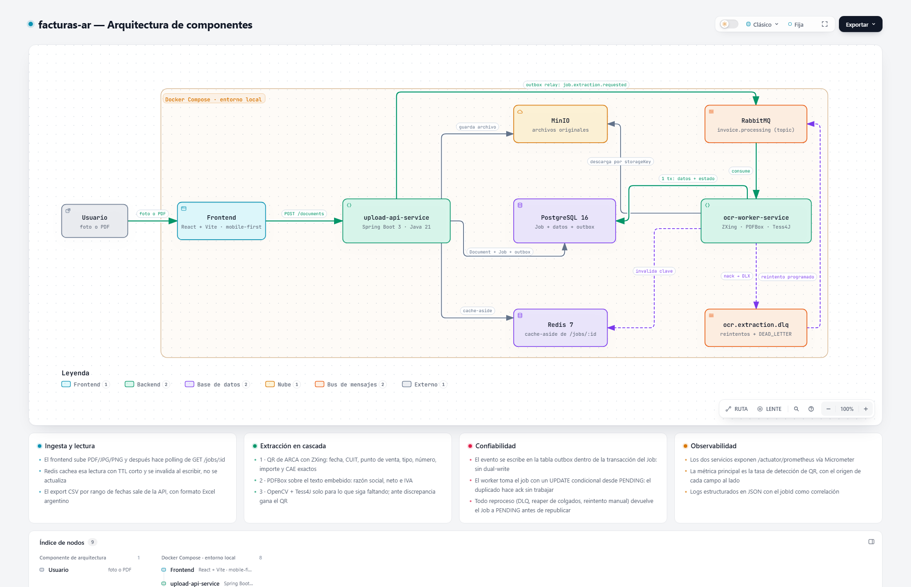
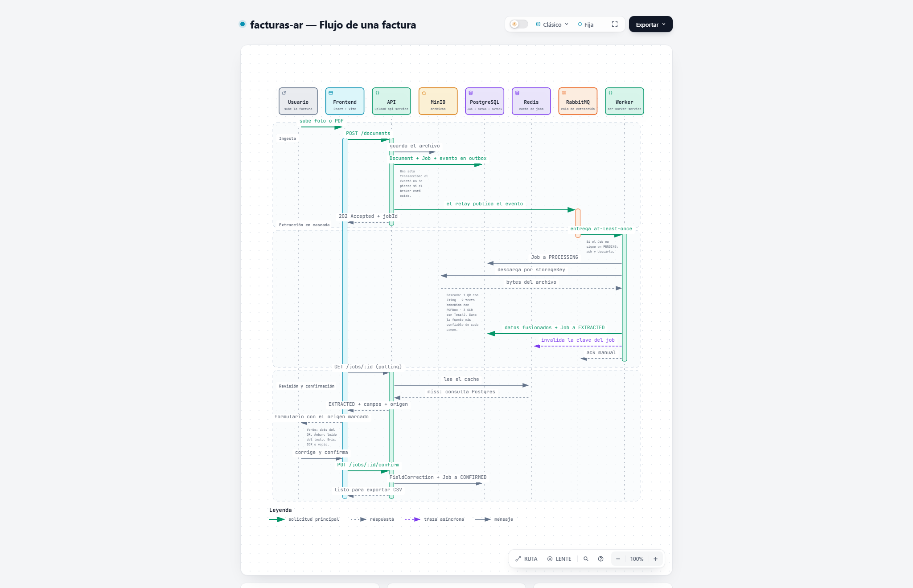

# facturas-ar — Documentación de Proyecto

> Extracción automática de datos de comprobantes fiscales argentinos (AFIP/ARCA): de una foto o un PDF a CSV.
>
> Backend developer junior (Java/Spring Boot) — proyecto de portfolio #3, enfocado en mensajería asíncrona, caching y observabilidad.

**Documentos de este repo:**

| Documento | Qué contiene |
|---|---|
| Este README | Qué se construye: alcance, arquitectura, esquema, stack, roadmap |
| [Análisis de dominio y diseño](docs/analisis-dominio-y-diseno.md) | Por qué el problema es así: perfiles de usuario, competencia, glosario fiscal, casos de uso detallados, patrones justificados y descartados |
| [Decisiones de arquitectura](docs/adr/) | Los ocho ADRs: por qué cada cosa es así y no de otra forma, con las alternativas que se descartaron |

---

## 0. Arranque rápido

Requisitos: Docker y nada más. El JDK y Maven solo hacen falta si vas a
tocar el código — la imagen compila adentro con el wrapper versionado.

```bash
docker compose up -d --wait
```

Levanta Postgres, el almacenamiento S3-compatible y la API, en ese orden,
esperando a que cada uno esté sano. Después:

| Qué | Dónde |
|---|---|
| API | http://localhost:8080 |
| Estado del servicio | http://localhost:8080/actuator/health |
| Métricas | http://localhost:8080/actuator/prometheus |
| Postgres | `localhost:5433`, base/usuario/clave `facturas` |
| Almacenamiento S3 | http://localhost:9090 |

> **Postgres va en el 5433 a propósito.** El 5432 suele estar ocupado por
> una instalación nativa, y con los dos escuchando la aplicación se
> conecta a la base equivocada y falla con un error de autenticación que
> no dice nada de todo esto.

Para desarrollar, lo habitual es levantar solo la infraestructura y correr
la app desde el IDE:

```bash
docker compose up -d postgres s3
./mvnw spring-boot:run -pl upload-api-service
```

Y para empezar de cero, incluida la base:

```bash
docker compose down -v
```

## 1. Visión y objetivo

El usuario sube una factura (PDF o foto), el sistema extrae automáticamente los datos relevantes (proveedor, CUIT, fecha, tipo y número de comprobante, CAE, neto, IVA, total) y permite exportar a CSV o PDF prolijo. Resuelve un problema tedioso real (carga manual de datos) para freelancers, monotributistas y cualquiera que junta tickets/facturas.

**Ventaja de nicho:** foco en facturas argentinas (AFIP/ARCA), que son bastante estandarizadas — ventaja competitiva frente a herramientas genéricas en inglés. Más concreto todavía: desde 2021 **toda factura electrónica argentina lleva un código QR obligatorio** ([RG 4892/2020](https://www.afip.gob.ar/fe/qr/documentos/QRespecificaciones.pdf)) que codifica los datos del comprobante en JSON. Eso convierte al OCR en el último recurso en vez del motor del sistema — ver [sección 6](#6-extracción-de-datos).

**Por qué este proyecto:** los dos proyectos anteriores del portfolio ya demuestran profundidad backend (hexagonal/DDD, JWT/RBAC, auditoría de seguridad, 108 tests, CI/CD). Este proyecto cubre lo que falta — mensajería asíncrona, caching (Redis) y observabilidad — de forma justificada por el problema de negocio, no "pegada con cinta".

**Objetivo del proyecto:** sumar un tercer proyecto sólido al portfolio que demuestre mensajería asíncrona, caching y observabilidad de forma justificada por un problema real — no conseguir usuarios ni construir un producto. Compartirlo con algunas personas reales (ver sección 2) es una validación opcional que mejora la narrativa del portfolio, no un objetivo en sí mismo.

### Por qué no alcanza con "Mis Comprobantes" de ARCA

ARCA ya ofrece gratis un servicio donde cualquier contribuyente con clave fiscal ve sus comprobantes emitidos y recibidos, filtra por período (hasta 365 días) y los exporta a CSV. Vale enfrentar la comparación de frente, porque es la primera objeción razonable al proyecto:

| Limitación de Mis Comprobantes | Qué cubre este proyecto |
|---|---|
| Solo aparece lo que se emitió **a tu CUIT** | Las facturas B a consumidor final, tickets de combustible, gastos de viaje y compras en comercios chicos no están ahí |
| No están los comprobantes no electrónicos | Tickets fiscales viejos, comprobantes manuales, papel |
| Datos incompletos: comprobantes con percepciones y montos en moneda extranjera vienen mal | La extracción lee el comprobante real |
| **No hay API**: la única vía es entrar al portal y descargar a mano | Ingesta por upload, sin clave fiscal de por medio |
| Te da la fila, no el archivo | El PDF o la foto queda pegado al dato, recuperable para una auditoría |

> En una frase: *Mis Comprobantes cubre lo que ARCA ya sabe de vos; esto cubre la pila de papel y PDFs que ARCA no sabe, y te deja el archivo original junto al dato.*

---

## 2. Validación opcional: prueba informal con un par de personas

El orden técnico del roadmap (sync → cola/Redis → observabilidad → pulido) es el camino principal del proyecto y no depende de esto.

**Sugerencia opcional, no bloqueante:** al terminar la Fase 1 (ver sección 10), si hay tiempo y ganas, mostrar el sistema funcionando (sync) a 2-3 personas (podés usar tus propias facturas o pedirle a algún conocido monotributista que pruebe). No es un lanzamiento ni requiere esfuerzo de difusión en comunidades — el objetivo es simplemente juntar un puñado de casos reales de fotos de celular (mala luz, ángulo torcido, formatos de ticket distintos) que vos solo no vas a generar con datos de prueba propios. Si sale, suma como dato concreto para el README ("probado con N facturas reales, X% de precisión en campos clave"); si no hay tiempo, no afecta el avance del proyecto — se puede seguir directamente a la Fase 2 con datos de prueba generados por vos.

---

## 3. Alcance del MVP (v1)

### Decisión de auth
**Auth simple (email/password, sin roles ni RBAC)** + historial + export por rango de fechas. El RBAC ya está demostrado en otro proyecto del portfolio, no hace falta repetir profundidad ahí.

### Incluido en v1

| Área | Alcance |
|---|---|
| **Perfil objetivo** | **Monotributista**, registrando los comprobantes que recibe. Decidido — ver [análisis de dominio §1.2](docs/analisis-dominio-y-diseno.md). El responsable inscripto queda para v2: necesita IVA por alícuota y percepciones, que es todo lo que el QR no trae |
| Ingesta | Subida de PDF o foto (JPG/PNG) desde web, responsive (mobile-first, porque la gente saca fotos desde el celular) |
| Extracción | **Del QR (exactos):** CUIT emisor, tipo de comprobante, punto de venta, número, fecha de emisión, importe total, moneda, cotización, documento del receptor, CAE. **Del texto/OCR:** razón social del emisor — y nada más |
| Revisión | Formulario editable con los campos extraídos antes de confirmar, **marcando el origen de cada campo** (QR, texto embebido u OCR). Los que vienen del QR son solo lectura por defecto |
| Historial | Lista de facturas cargadas por usuario, con estado y filtro por fecha |
| Export | CSV de un lote (rango de fechas) y PDF prolijo de una factura individual |
| Confiabilidad | Reintentos automáticos en el worker; si falla definitivamente, reintento manual o recarga |
| Auth | Simple, solo para separar datos por usuario |

### Explícitamente fuera de scope v1

- **Ítems de línea** (detalle producto por producto) — complejidad de parseo de tablas no justificada; totales alcanzan para el 90% del caso de uso contable.
- **Neto gravado, IVA e IVA discriminado por alícuota**, y **percepciones** de IVA/IIBB — son los campos que necesita un responsable inscripto para el Libro IVA Digital, y justo los que el QR no trae. Un monotributista no toma crédito fiscal, así que no le sirven; además, en los comprobantes que recibe muchas veces **ni siquiera existen** (la factura C no lleva IVA y la B lo lleva incluido sin discriminar). Las columnas quedan en el esquema preparadas para v2, pero v1 no las extrae ni las pide. v2.
- Validación del CAE contra ARCA (webservice de constatación) — es barata ahora que el QR entrega el CAE, pero requiere certificado y clave fiscal: fricción de setup. v1.1, con buenas chances de adelantarse.
- Carga por lote (ZIP con múltiples archivos) — v1.1.
- Ingesta por mail (reenviar factura a una casilla) — v2, buen gancho de retención pero necesita infra de mail entrante.
- Multi-tenant / equipos / compartir con contador — v2.
- Modelo de ML propio — se arranca con reglas; el dataset de correcciones (`FieldCorrection`) se guarda desde el día 1 para habilitar esto a futuro.

### Criterios de aceptación del MVP

1. **PDF de factura electrónica con QR legible → los 10 campos del QR correctos, en el 100% de los casos** de un set de al menos 20 comprobantes reales variados. No es un umbral optimista: el QR es un dato estructurado, o se lee o no se lee.
2. **Foto de celular** de una factura electrónica impresa, con luz razonable → QR detectado en **≥ 85%** de los casos.
3. Comprobante **sin** QR → degrada a texto/OCR sin romperse; el usuario puede completar a mano.
4. Usuario puede corregir cualquier campo y confirmar; cada corrección queda registrada.
5. El archivo original siempre es recuperable, sin importar cómo haya salido la extracción. Un archivo ilegible o que no es una factura **no es un fallo del sistema**: el formulario sale vacío y el documento queda guardado igual.
6. Export CSV de un rango de fechas que abre en Excel y Sheets con montos como números y acentos correctos, **sin intervención manual**.
7. Un usuario no puede acceder a datos de otro — con test automatizado que lo demuestre.
8. El sistema sobrevive a que el worker se caiga a mitad de un procesamiento: el mensaje se reprocesa y el resultado no se duplica. *(Fase 2 — es el criterio que justifica toda la mensajería.)*
9. Siempre hay feedback visible de estado ("procesando"), aunque la Fase 1 sea síncrona.

---

## 4. Arquitectura general

Los diagramas se generan con [Archify](https://github.com/tt-a1i/archify) a partir del JSON tipado que vive en [docs/diagrams/](docs/diagrams/). Cada uno se publica como un HTML interactivo (temas claro/oscuro, foco por nodo, trazado de rutas, export a imagen). Abajo va la vista estática, porque GitHub no renderiza el HTML del repo: para la versión navegable, abrí el archivo después de clonar.

### Vista de componentes (estado final, post Fase 2)

<picture>
  <source media="(prefers-color-scheme: dark)" srcset="docs/diagrams/arquitectura-dark.png">
  
</picture>

**[Abrir diagrama interactivo](docs/diagrams/arquitectura.html)** · fuente: [arquitectura.architecture.json](docs/diagrams/arquitectura.architecture.json)

### Responsabilidades por componente

| Componente | Responsabilidad | Qué **no** hace |
|---|---|---|
| `frontend` | Upload, encuadre de la foto, polling de estado, formulario de revisión, historial y export | Nada de OCR ni reglas de parseo |
| `upload-api-service` | Auth, persistencia de `Document`/`Job`, subida al storage, escritura del evento en la tabla outbox, lectura cacheada, export CSV/PDF | No extrae nada: no conoce ZXing ni Tesseract |
| `ocr-worker-service` | Consume la cola y corre la **cascada de extracción** (QR → texto embebido → OCR), fusiona por confianza, persiste resultado e invalida cache | No conoce al usuario (el evento no lleva `userId`) |
| `RabbitMQ` | Desacople y buffer entre ingesta y procesamiento, reintentos y dead-letter | No transporta el archivo (solo el `storageKey`) |
| `Redis` | Cache-aside de `GET /jobs/:id` (polling intensivo del frontend) | No es fuente de verdad: se invalida, no se actualiza |
| Almacenamiento S3 | Guarda los archivos originales. S3Mock en desarrollo, cualquier backend S3-compatible en producción | — |
| `Prometheus` + `Grafana` | Scrapeo de métricas de ambos servicios y dashboards | — |

### Flujo de una factura, de punta a punta

<picture>
  <source media="(prefers-color-scheme: dark)" srcset="docs/diagrams/flujo-factura-dark.png">
  
</picture>

**[Abrir diagrama interactivo](docs/diagrams/flujo-factura.html)** · fuente: [flujo-factura.sequence.json](docs/diagrams/flujo-factura.sequence.json)

> **Fase 1 (sync):** el mismo flujo corre dentro del `upload-api-service`, sin RabbitMQ, Redis, outbox ni worker separado — la cascada de extracción se ejecuta en el request y el estado salta de `PENDING` a `EXTRACTED` en el mismo hilo. La Fase 2 solo mueve el pipeline detrás de la cola, sin cambiar el modelo de datos ni los estados del `Job`. Ver sección 10 (Roadmap).

### Regenerar los diagramas

Archify no es dependencia del proyecto: se edita el JSON y se vuelve a renderizar.

```bash
# instalar el skill para el agente (una vez)
npx skills add tt-a1i/archify -g

# o usar el CLI directo desde un clon del repo de Archify
node <ruta>/archify/bin/archify.mjs finalize architecture \
  docs/diagrams/arquitectura.architecture.json docs/diagrams/arquitectura.html --quality showcase
```

Las vistas estáticas (`*-light.png` / `*-dark.png`) salen de `archify visual-check <html> --out-dir <dir>`.

---

## 5. Esquema de datos

### Diagrama de entidades

```
User
 └─< Document (1:N)
       └─< Job (1:N)            -- 1:N para permitir reprocesar sin resubir archivo
             ├─1:1 ExtractedInvoiceData
             └─<  FieldCorrection (1:N)

OutboxEvent                      -- tabla suelta, sin FK: su vida es más corta que la del Job
```

### `User`
```
id (uuid)
email
password_hash
created_at
```

### `Document`
```
id (uuid)
user_id (FK)
original_filename
storage_key          -- clave opaca en el almacenamiento S3
mime_type
file_size_bytes
content_hash          -- sha256, deduplication ("you already uploaded this invoice")
source_type            -- PDF_TEXT | PDF_SCANNED | IMAGE
qr_detected            -- boolean; métrica de primera clase del pipeline
uploaded_at
```

### `Job`
```
id (uuid)
document_id (FK)
status                 -- see states table
retry_count
max_retries             -- e.g. 3
error_message           -- nullable, only if FAILED/DEAD_LETTER
ocr_engine              -- "tesseract-5.3", to compare engines in the future
overall_confidence      -- 0-1, aggregated score
duplicate_of_job_id     -- nullable, FK a jobs; obligatorio si status=DUPLICATE
created_at
started_at              -- nullable
completed_at            -- nullable
```

**Estados del Job:**

| Estado | ¿Procesable? | Significado |
|---|---|---|
| `PENDING` | **sí** | Encolado, esperando worker. **El único estado desde el que se puede empezar a trabajar** |
| `PROCESSING` | no | Un worker lo tiene tomado. Si llega otro mensaje para este job, es un duplicado |
| `EXTRACTED` | no | La extracción terminó, listo para revisión del usuario (no hay estado separado de "baja confianza": el formulario siempre es editable) |
| `CONFIRMED` | no | Usuario revisó/corrigió y aprobó — entra al historial exportable |
| `DUPLICATE` | no | El comprobante ya estaba cargado por este usuario. `duplicate_of_job_id` apunta al original. El archivo se conserva; lo que no se duplica es el dato extraído |
| `FAILED` | no | El último intento falló por un error recuperable (timeout, error transitorio). Estado de reposo: **espera a que el reintentador lo devuelva a `PENDING`**, no se procesa desde acá |
| `DEAD_LETTER` | no | Agotó reintentos o archivo irrecuperable — requiere acción manual del usuario |

**Transiciones válidas:**

```
PENDING ──claim──> PROCESSING ──> EXTRACTED ──> CONFIRMED
                        │
                        ├── ya cargado por este usuario ──> DUPLICATE
                        │
                        ├── error recuperable ──> FAILED ──┐
                        │                                   │
                        └── colgado (reaper) ───────────────┤
                                                            │
                        retry_count < max_retries ──────────┴──> PENDING
                        retry_count >= max_retries ─────────────> DEAD_LETTER

                        DEAD_LETTER ──reintento manual del usuario──> PENDING
```

> **Hay una sola puerta de entrada al trabajo: `PENDING`.** El reintento del DLQ, el reaper de jobs colgados y el botón de reintento manual hacen todos lo mismo — devolver el job a `PENDING` y republicar. Esto es lo que hace que la idempotencia sea una regla de una línea en vez de una lista de casos especiales.

### `ExtractedInvoiceData` (1:1 con Job)
```
job_id (FK, PK)
user_id                     -- denormalizado desde documents.user_id (ver abajo)

-- Campos que vienen del QR (exactos cuando hay QR legible)
issuer_cuit                 -- bigint, con dígito verificador validado
invoice_type_code           -- int, código de la tabla oficial de ARCA (1=Fact A, 6=B, 11=C...)
point_of_sale               -- int, hasta 5 dígitos
invoice_number              -- int, hasta 8 dígitos
issue_date                  -- date
total                       -- numeric(15,2)
currency                    -- varchar(3), "PES" | "DOL" | ...
exchange_rate               -- numeric(19,6), cotización a pesos (1 si es ARS)
recipient_doc_type          -- int (80=CUIT, 86=CUIL, 96=DNI, 99=sin identificar)
recipient_doc_number        -- numeric(20)
cae                         -- bigint, código de autorización
auth_code_type              -- varchar(1), "E"=CAE | "A"=CAEA

-- Campos que el QR NO trae: salen del texto embebido o del OCR
issuer_business_name
net_amount                  -- numeric(15,2), neto gravado
vat_amount                  -- numeric(15,2), IVA total (sin discriminar por alícuota en v1)
recipient_vat_condition     -- REGISTERED_TAXPAYER | MONOTRIBUTO | FINAL_CONSUMER | ...

-- Trazabilidad de la extracción
qr_payload_raw              -- jsonb, el JSON crudo decodificado del QR
raw_ocr_text                -- texto completo del OCR o del PDF, para reparsear sin reprocesar
field_sources               -- jsonb, {"total": "QR", "issuer_business_name": "OCR", ...}
field_confidence            -- jsonb, {"issuer_cuit": 1.0, "net_amount": 0.60, ...}
```

> **Todos los montos en `NUMERIC`, nunca `float`/`double`/`REAL`.** El QR especifica el importe con hasta 13 enteros y 2 decimales, y la cotización con hasta 6 decimales.
>
> **Nada de `CHAR(n)`.** Postgres lo desaconseja: rellena con espacios y tiene semántica de comparación propia, sin ventaja a cambio. Y los identificadores que entran holgados en un `long` (CUIT, CAE) van en `BIGINT` y no en `NUMERIC`.
>
> `qr_payload_raw` y `raw_ocr_text` permiten reparsear jobs históricos si se mejoran las reglas, sin volver a correr Tesseract (la parte cara).
>
> `field_sources` es lo que habilita el indicador visual del formulario de revisión: el usuario ve de dónde salió cada dato.

**Índices obligatorios:**

```sql
-- En documents: misma ARCHIVO, mismo usuario. Atrapa el doble clic.
UNIQUE (user_id, content_hash)

-- En extracted_invoice_data: mismo COMPROBANTE, mismo usuario.
-- Parcial, para que las extracciones fallidas (todo NULL) no choquen entre sí.
UNIQUE (user_id, issuer_cuit, invoice_type_code, point_of_sale, invoice_number)
   WHERE issuer_cuit IS NOT NULL AND invoice_type_code IS NOT NULL
     AND point_of_sale IS NOT NULL AND invoice_number IS NOT NULL

INDEX (user_id, issue_date)        -- historial y export, sin joins
INDEX (status) WHERE status IN ('PENDING','PROCESSING')   -- claim atómico
```

**Por qué `user_id` está denormalizado en `extracted_invoice_data`:** por dos motivos independientes. Es la única forma de expresar *"este comprobante ya lo cargó este usuario"* como restricción de base, y el export filtra por usuario y fecha — sin la columna hay que joinear `jobs` y `documents` solo para saber de quién es la fila. Es además la clase segura de denormalización: el dueño de un documento no cambia nunca.

**Por qué el hash del archivo no alcanza:** atrapa el doble clic, no la duplicación real. Se escapan dos casos frecuentes — tener el PDF del mail *y* la foto del impreso (dos archivos, mismo comprobante), y volver a descargar la factura del portal del proveedor cuando el PDF regenerado difiere en un byte de metadata. La identidad fiscal `(CUIT, tipo, punto de venta, número)` sí los atrapa, y **el QR nos la da exacta**: tenemos una clave de deduplicación confiable justamente por haber puesto el QR primero.

**Por qué por usuario y no global:** dos personas pueden cargar el mismo comprobante legítimamente — una pareja con la factura de luz, dos socios con la del proveedor.

> La detección va en la aplicación: consulta antes de insertar y marca el `Job` como `DUPLICATE` con un mensaje útil (*"ya cargaste este comprobante el 3 de marzo"*), no con un error de constraint. El índice único es la red de seguridad contra la carrera de dos subidas simultáneas — ahí se captura la violación y se convierte en `DUPLICATE` igual.

### `OutboxEvent`
```
id (uuid)
aggregate_id               -- el jobId
event_type                 -- "job.extraction.requested"
payload                    -- jsonb
created_at
published_at               -- nullable; null = pendiente de publicar
```

> Se escribe en la **misma transacción** que el `Job`. Un relay la vacía contra RabbitMQ. Ver sección 8.

### `FieldCorrection` (1:N con Job)
```
id
job_id (FK)
field_name
original_value       -- what the OCR produced
corrected_value       -- what the user entered
corrected_at
```

> Dataset base para: (1) métrica de qué campo falla más, (2) futuro entrenamiento de modelo si se abandona el approach de reglas.

---

## 6. Extracción de datos

### El dato que define el diseño: el QR obligatorio

Desde 2021 ([RG 4892/2020](http://biblioteca.afip.gob.ar/dcp/REAG01004892_2020_12_22)) toda factura electrónica argentina lleva un código QR. **No es un link a un sitio de consulta:** codifica los datos del comprobante en JSON, en Base64, dentro de la URL.

```
https://www.arca.gob.ar/fe/qr/?p={JSON en Base64}
```

```json
{"ver":1,"fecha":"2020-10-13","cuit":30000000007,"ptoVta":10,"tipoCmp":1,
 "nroCmp":94,"importe":12100,"moneda":"DOL","ctz":65,"tipoDocRec":80,
 "nroDocRec":20000000001,"tipoCodAut":"E","codAut":70417054367476}
```

Eso significa que **los campos más críticos del MVP no necesitan OCR**: salen exactos, sin ambigüedad y sin score de confianza inventado. El OCR queda para lo que el QR no trae — razón social, neto e IVA.

> **[ADR 004 — QR primero, OCR de último recurso](docs/adr/004-qr-primero-ocr-de-respaldo.md).** La decisión técnica más importante del proyecto, con las dos diferencias que aparecieron entre la especificación de ARCA y lo que ARCA realmente emite.

### Cascada de tres estrategias

El worker corre las estrategias en orden de prioridad y **cada campo se queda con el valor de la fuente más confiable que lo haya producido**.

| # | Estrategia | Librería | Confianza | Qué aporta |
|---|---|---|---|---|
| 1 | **QR** | ZXing | 1.0 | fecha, CUIT, punto de venta, tipo, número, importe, moneda, cotización, doc. receptor, CAE |
| 2 | **Texto embebido** | Apache PDFBox | ~0.9 | razón social, neto, IVA — solo si el PDF trae texto |
| 3 | **OCR** | OpenCV + Tess4J | 0.3 – 0.8 | lo que siga faltando, en fotos y PDFs escaneados |

```java
public interface ExtractionStrategy {
    boolean supports(SourceType sourceType);
    ExtractionResult extract(DocumentContent content);
    int priority();          // QR=100, PDF_TEXT=50, OCR=10
}

public record ExtractedField<T>(T value, double confidence, FieldSource source) {}
```

Agregar una estrategia nueva (PaddleOCR en v2, por ejemplo) no toca el orquestador: es una clase más y una línea de registro.

### Clasificación del origen

`PDFTextStripper` devuelve >50 caracteres → `PDF_TEXT`. Vacío o casi vacío → `PDF_SCANNED`. Imagen → `IMAGE`. Esto decide qué estrategias se corren, no si hay QR: **el QR se busca siempre**, rasterizando la primera página con `PDFRenderer` cuando es PDF.

### Detección del QR

- ZXing (`com.google.zxing:core` + `javase`), probando las cuatro rotaciones (0/90/180/270).
- Si hay QR pero el Base64 no decodifica o el JSON no valida contra el schema v1 → se ignora y se sigue por texto/OCR, registrando la anomalía (puede ser un QR falso).
- **El preprocesamiento de imagen cambia de objetivo:** el deskew y la binarización ahora sirven, en primer lugar, para que ZXing encuentre el código. Que además ayuden a Tesseract es un beneficio secundario.

### Preprocesamiento de imagen

Con OpenCV (`org.openpnp:opencv`, o `boofcv` si da problemas de portabilidad):

1. **Escala de grises**
2. **Corrección de deskew** (transformada de Hough) — el paso de mayor impacto en fotos reales de celular
3. **Binarización adaptativa** (Gaussian) — crítico con luz despareja o sombras
4. **Eliminación de ruido** (median blur leve antes de binarizar)
5. **Detección/recorte de bordes del documento** — *diferido a v1.1*; en v1, guía visual de encuadre en el frontend

Tesseract con `--psm 6` (bloque uniforme de texto) como modo inicial.

> OpenCV pasa de ser crítico a secundario: si da problemas de portabilidad, **no bloquea el MVP**.

### Parseo de campos sobre texto (reglas + regex)

Componente compartido entre la estrategia de texto embebido y la de OCR — recibe texto plano, no sabe de dónde salió. **No duplicar estas reglas entre estrategias:** es la parte del código que más va a cambiar.

- **`issuer_business_name`:** heurística de posición en las primeras líneas del bloque del emisor.
- **`net_amount` / `vat_amount`:** etiquetas ("Subtotal", "Neto", "IVA") + regex de montos en formato argentino (`$ 1.234,56`).
- **`recipient_vat_condition`:** match contra el vocabulario fijo de AFIP ("Responsable Inscripto", "Consumidor Final", "Monotributo"...).
- **`issuer_cuit` / `issue_date` / `total`:** reglas de respaldo, solo usadas si no hubo QR.

### Verificación cruzada

Como se tienen los valores de **todas** las fuentes y no solo el ganador, la confianza se puede calcular en vez de inventar:

- ¿El total del QR coincide con el leído por OCR? → refuerza ambos.
- ¿`neto + IVA ≈ total`? → refuerza.
- ¿El **dígito verificador del CUIT** cierra? → refuerza.
- Discrepancia → **gana el QR**, y se registra.

### Validación y corrección del CUIT

El último dígito de un CUIT es verificador (módulo 11), lo que da validación y corrección asistida gratis:

```
pesos  = [5,4,3,2,7,6,5,4,3,2]   // sobre los primeros 10 dígitos
suma   = Σ digito[i] * pesos[i]
dv     = 11 - (suma % 11)
si dv == 11 → dv = 0
si dv == 10 → dv = 9
```

Si el OCR leyó 11 dígitos y el verificador no cierra, se prueban las confusiones típicas (`8↔3`, `5↔6`, `1↔7`, `0↔O`): si una sola combinación valida, la probabilidad de acierto es alta.

> Esto vive en un **value object `Cuit`** que no se puede instanciar inválido.

### Códigos de tipo de comprobante

El QR devuelve `tipoCmp` como código numérico de la [tabla oficial de ARCA](https://www.afip.gob.ar/fe/documentos/TABLACOMPROBANTES.xls). El subconjunto relevante:

| Código | Comprobante | Signo |
|---|---|---|
| 1 / 2 / 3 | Factura A / Nota de Débito A / **Nota de Crédito A** | + / + / **−** |
| 6 / 7 / 8 | Factura B / ND B / **NC B** | + / + / **−** |
| 11 / 12 / 13 | Factura C / ND C / **NC C** | + / + / **−** |
| 19 | Factura E (exportación) | + |
| 51 | Factura M | + |
| 81 / 82 / 111 | Tique Factura A / B / C | + |
| 201 / 206 / 211 | FCE MiPyME A / B / C | + |

> **Las notas de crédito restan.** El signo va en el enum `TipoComprobante`, no en un `if` perdido en el servicio de export.

---

## 7. Stack técnico

### Upload/API Service
- Java 21 (LTS) + Spring Boot 4.1.1
- Maven, con wrapper (`mvnw`) versionado: no hace falta tener Maven instalado para compilar
- Spring Data JPA + PostgreSQL 16
- Flyway (migraciones)
- Almacenamiento de objetos S3-compatible vía SDK `software.amazon.awssdk:s3`. En desarrollo corre **Adobe S3Mock**; ver la nota al pie de esta sección
- Spring AMQP (`spring-boot-starter-amqp`)
- Bean Validation
- springdoc-openapi (Swagger UI)

### Cola de mensajes
- RabbitMQ 3.13.x
- Exchange tipo `topic`
- Dead-letter exchange nativo de RabbitMQ

### Worker de extracción
- Java 21 + Spring Boot 4.1.1 (módulo separado, Fase 2)
- **ZXing** (`com.google.zxing:core` + `com.google.zxing:javase`) — detección y decodificación del QR. **La dependencia más importante del proyecto**
- Apache PDFBox 3.x — texto embebido (`PDFTextStripper`) y rasterizado de la página para buscar el QR (`PDFRenderer`)
- Jackson — parseo del JSON del QR (ya viene con Spring Boot)
- Tess4J 5.x (Tesseract 5.3+ en el contenedor: `tesseract-ocr tesseract-ocr-spa`) — estrategia de último recurso
- `org.openpnp:opencv` (OpenCV 4.x) o `boofcv` como alternativa — preprocesamiento, no bloqueante
- Parseo de texto: regex + Java puro, sin librería
- `@RabbitListener` con `acknowledge-mode: manual`

### Redis
- Redis 7.x, Spring Data Redis (Lettuce)
- Uso: cache-aside simple en `GET /jobs/{id}`, TTL corto (~30s), invalidación por delete on-write

### Testing
- JUnit 5 + AssertJ
- **Testcontainers** — Postgres, RabbitMQ y el almacenamiento de objetos reales en los tests de integración. Para un proyecto cuyo argumento es "sé manejar infraestructura asíncrona", testear contra H2 y mocks contradice el argumento
- Set de comprobantes reales versionado como fixtures de la cascada de extracción

### Export
- CSV: Apache Commons CSV o OpenCSV (nunca a mano con StringBuilder)
- PDF: Apache PDFBox (Apache 2.0 — evitar iText, es AGPL/comercial)

**Formato del CSV — los detalles que arruinan el archivo si se ignoran:**

| Regla | Por qué |
|---|---|
| Separador `;` | Excel en configuración regional argentina lee `,` como decimal: con comas, todo cae en una sola columna |
| UTF-8 **con BOM** | Sin BOM, Excel rompe acentos y eñes |
| Decimales con coma (`12100,50`) | Para que Excel lo reconozca como número y sea sumable |
| Fechas `dd/mm/yyyy` | Estándar AFIP |
| Notas de crédito en negativo | Si no, el total del período está mal |
| Columnas `cae` y `tipo_comprobante` (código numérico) | Lo hace importable a software contable |

> Probarlo con Excel real, no solo con Sheets. Un export que el usuario tiene que arreglar a mano es exactamente el problema que el proyecto dice resolver.

### Observabilidad
- Micrometer (Spring Boot Actuator) + `micrometer-registry-prometheus`
- Prometheus 2.5x + Grafana
- Métricas custom clave:
  - `invoice.qr.detection.rate` (Counter, tag `detected`) — **la métrica más importante del sistema**: es el indicador de salud del pipeline entero
  - `invoice.extraction.source` (Counter, tags `field` y `source`) — qué proporción de cada campo viene del QR, del texto o del OCR. Dice exactamente dónde invertir esfuerzo
  - `invoice.field.correction.rate` (Counter, tag `field`) — qué campo corrige más el usuario = qué regla de parseo está peor
  - `invoice.job.processing.time` (Timer, tag `strategy`) — el QR debe medirse en milisegundos, el OCR en segundos
  - `invoice.job.outcome` (Counter, tag `status`)
  - `invoice.ocr.confidence` (DistributionSummary)
- Logs estructurados JSON (`logstash-logback-encoder`)
- Opcional (si sobra tiempo): Micrometer Tracing + Zipkin para seguir `jobId` end-to-end

> Un dashboard con "tasa de detección de QR" y "origen de cada campo" es mucho más interesante de mostrar que uno con uso de CPU: habla del problema, no de la máquina.

### Frontend
- React + Vite, sin Redux (React Query alcanza para polling de estado)
- Alternativa más rápida: Thymeleaf server-side dentro del Upload Service (descartada, mobile UX peor)

### Infraestructura local
- Docker Compose. Hoy levanta lo que el código usa: **Postgres 16**, **Adobe S3Mock** y la propia API. RabbitMQ, Redis, Prometheus y Grafana entran en las Fases 2 y 3.
- La API se construye con un **Dockerfile multi-stage** que parte el jar en capas (`jarmode=tools extract --layers`). Importa: el jar pesa 208 MB y copiarlo entero reescribía todo ante cualquier cambio; partido, la capa de código propio pesa 143 kB.
- GitHub Actions: `./mvnw verify` y build de la imagen en cada push y PR a main

> **Por qué S3Mock y no MinIO.** El plan original era MinIO, pero sus imágenes dejaron de ser públicas: tanto Docker Hub como quay.io piden login. La segunda opción, LocalStack, ahora exige `LOCALSTACK_AUTH_TOKEN` y sale con error sin él. S3Mock es Apache 2.0 y arranca sin credenciales ni registro.
>
> **El código no cambia:** va por el SDK de S3 igual, así que apuntar a S3 real, a MinIO o a cualquier otro backend es cambiar un endpoint. Esa es toda la razón por la que el almacenamiento está detrás de un puerto.

---

## 8. Contratos de eventos

### Exchange

```
Exchange: invoice.processing (tipo: topic)
  └─ Routing key: job.extraction.requested → Queue: ocr.extraction.queue
       (DLX tras agotar reintentos) → Queue: ocr.extraction.dlq
```

Config de la cola principal:
```
x-dead-letter-exchange: invoice.processing.dlx
x-dead-letter-routing-key: job.extraction.failed
```

### Evento: `job.extraction.requested`

Escrito por el Upload Service en la tabla `OutboxEvent`, en la misma transacción que crea el `Job` en `PENDING`. Un relay lo publica después (ver abajo).

```json
{
  "eventId": "a1b2c3d4-...",
  "eventType": "job.extraction.requested",
  "eventVersion": 1,
  "occurredAt": "2026-10-05T03:00:00Z",
  "payload": {
    "jobId": "uuid",
    "documentId": "uuid",
    "storageKey": "documents/2026/10/uuid.pdf",
    "mimeType": "application/pdf",
    "sourceType": "PDF_SCANNED"
  }
}
```

- Payload liviano (solo `storageKey`, no el archivo ni datos parseados) — mantiene la cola rápida.
- `eventId` + `eventVersion` desde el día 1: idempotencia, correlación de logs, evolución de schema sin romper compatibilidad entre despliegues no sincronizados.
- Sin `userId`: el worker se mantiene "ciego" al concepto de usuario — separación de responsabilidades consciente.

### Publicación: transactional outbox

El camino ingenuo es: persistir el `Job` → publicar a RabbitMQ. Son **dos sistemas distintos sin transacción común** (dual-write): si el broker está caído o el proceso muere entre las dos operaciones, queda un `Job` en `PENDING` que nadie va a procesar nunca, y el usuario ve un "procesando" eterno.

La solución:

```
1. Transacción única en Postgres:
     INSERT Document + Job (PENDING)
     INSERT OutboxEvent (published_at = null)
   COMMIT

2. Relay (@Scheduled, cada pocos segundos, o listener del commit):
     SELECT * FROM outbox_event WHERE published_at IS NULL
     publicar a RabbitMQ
     UPDATE published_at = now()
```

- Si el broker está caído, el evento espera en la tabla y se publica cuando vuelve. Nada se pierde.
- Si el relay publica y muere antes del `UPDATE`, el evento se publica dos veces — **y eso está bien**, porque el consumidor ya es idempotente (ver más abajo). At-least-once de punta a punta.
- El `Job` nunca existe sin su evento, ni el evento sin su `Job`.

> **[ADR 005 — Transactional outbox](docs/adr/005-transactional-outbox.md).** Junto con el del QR, lo más sustancioso que el proyecto tiene para contar.
>
> **En Fase 1 no hace falta:** sin cola, no hay dual-write. Se introduce con la cola, en Fase 2.

### Respuesta del worker: sin evento de vuelta (Opción A — DB compartida)

**Decisión:** el worker escribe directo a la DB compartida (Postgres), no publica evento de respuesta. Razón: con un solo desarrollador y volumen inicial chico, un segundo círculo de mensajería es complejidad sin beneficio real. El valor de mensajería asíncrona ya está demostrado con el evento de entrada.

> Documentar como ADR (`001-shared-db-vs-response-event.md`): *"Evalué un evento de respuesta (`job.extraction.completed`) pero opté por escritura directa a DB compartida dado el volumen y topología de despliegue actuales; con múltiples workers escalando independientemente de la API, reconsideraría esto."*

**Flujo del worker al terminar:**
1. Corre la cascada de extracción (QR → texto embebido → OCR) y fusiona por confianza.
2. Persiste `ExtractedInvoiceData` + actualiza `Job.status` (transacción única).
3. Invalida (borra, no actualiza) la entrada de Redis para ese `jobId`.
4. `ack` manual del mensaje recién después de confirmar la persistencia en DB.

### Reintentos y dead-letter

```
intento falla → Job.status = FAILED
  → nack (requeue=false) → RabbitMQ rutea a DLX → ocr.extraction.dlq
    → listener en DLQ incrementa Job.retry_count
      → si retry_count < max_retries:
            Job.status = FAILED → PENDING   ← vuelve a la única puerta de entrada
            republica el evento (scheduled task simple, sin plugin de delay en v1)
      → si retry_count >= max_retries:
            Job.status = DEAD_LETTER, queda como registro histórico
```

**Lo importante:** el reintento **no republica un job en `FAILED`**. Primero lo devuelve a `PENDING` y recién ahí publica. Si no, una copia vieja del mensaje original (el outbox puede publicar dos veces, ver arriba) sería indistinguible del reintento deliberado, y las dos se procesarían.

### Jobs colgados: el reaper

Si un worker muere entre el claim y el `ack`, el job queda en `PROCESSING` para siempre — nadie lo va a tomar, porque `PROCESSING` no es un estado procesable.

```java
@Scheduled(fixedDelay = 60_000)
void recuperarJobsColgados() {
    // UPDATE job SET status='PENDING', retry_count = retry_count + 1
    //  WHERE status='PROCESSING' AND started_at < now() - interval '10 minutes'
    //    AND retry_count < max_retries
    // ...y republicar los afectados
}
```

El timeout tiene que ser holgado respecto del peor caso real de OCR (un PDF escaneado de varias páginas), si no el reaper se roba jobs que todavía están corriendo. Medilo con `invoice.job.processing.time` antes de fijar el número.

### Idempotencia del worker: claim atómico

Contrato *at-least-once*: el mismo mensaje puede llegar más de una vez, y dos réplicas del worker pueden recibirlo a la vez. La regla es **una lista blanca de un solo estado**, aplicada como un compare-and-set atómico:

```sql
UPDATE job
   SET status = 'PROCESSING', started_at = now()
 WHERE id = :jobId
   AND status = 'PENDING';
```

- **1 fila afectada** → el worker se quedó con el job y procesa.
- **0 filas** → otro worker se lo llevó, o el job no está en un estado procesable → `ack` inmediato y descartar, sin trabajar.

> **Tiene que ser un `UPDATE` condicional, no un `SELECT` seguido de un `UPDATE`.** Entre el `SELECT` y el `UPDATE` hay una ventana en la que dos réplicas leen `PENDING` y las dos arrancan. Falla justo cuando escalás el worker, que es precisamente lo que esta arquitectura dice habilitar.
>
> **Lista blanca, no lista negra.** "Procesá solo si está en `PENDING`" es cerrado por defecto: el día que agregues un estado nuevo, queda afuera hasta que decidas lo contrario. "Descartá si está en A, B o C" es abierto por defecto, y el estado nuevo se empieza a procesar en silencio.

> **[ADR 007 — Claim atómico](docs/adr/007-claim-atomico.md):** por qué el worker toma el job con un `UPDATE` condicional y por qué todos los caminos de reproceso pasan por `PENDING`.

---

## 9. Estructura del repo (monorepo, multi-módulo Maven)

> **Esto es la estructura objetivo, no la foto de hoy.** Al momento de escribir esto existen `shared-domain`, `extraction` y `upload-api-service`; el resto se crea cuando le toque. Los módulos vacíos no se adelantan: uno que no hace nada durante seis semanas es ruido, no preparación.

**Por qué monorepo:** entidades JPA compartidas (DB única), un solo `docker-compose.yml` para todo el sistema, narrativa unificada de README/ADRs. Repos separados solo se justificarían con equipos/despliegues independientes, que no es el caso.

**Por qué `extraction` es un módulo propio y no vive adentro del worker:** en la Fase 1 la cascada la usa `upload-api-service` y en la Fase 2 la usa `ocr-worker-service`. Al estar afuera de los dos, pasar de síncrono a asíncrono es **agregar un deployable que la envuelve**, no mover código entre módulos. Además es el núcleo del dominio: parsear una factura no debería saber que existe un framework, así que el módulo no depende de Spring.

```
facturas-ar/
├── README.md
├── docker-compose.yml
├── docker-compose.override.yml.example
├── .github/workflows/
│   ├── ci.yml
│   └── docker-publish.yml
├── docs/
│   ├── architecture.md
│   ├── diagrams/                 # JSON de Archify + HTML/PNG generados
│   ├── adr/                        # 8 decisiones, con sus alternativas
│   └── api/
├── pom.xml                         # parent, packaging=pom
│
├── shared-domain/                  # plain Java, NO Spring Boot
│   └── src/main/java/.../domain/
│       ├── Job.java, Document.java, ExtractedInvoiceData.java
│       ├── FieldCorrection.java, User.java, OutboxEvent.java
│       ├── vo/ (Cuit, Importe, NumeroComprobante, Cae)
│       └── enums/ (JobStatus, SourceType, TipoComprobante, FieldSource...)
│
├── extraction/                     # plain Java, NO Spring Boot
│   └── src/main/java/.../extraction/
│       ├── ExtractionStrategy.java      # el puerto
│       ├── ExtractionOrchestrator.java  # cascada + fusión por confianza
│       ├── qr/                     # ZXing, Base64, JSON del QR
│       ├── pdftext/                # PDFBox
│       ├── ocr/                    # Tess4J, preprocesamiento OpenCV
│       └── parser/                 # reglas AFIP sobre texto plano
│
├── upload-api-service/             # runnable Spring Boot app
│   ├── Dockerfile
│   └── src/main/java/.../
│       ├── controller/, service/, repository/
│       └── config/                 # RabbitMQ, Redis, almacenamiento S3
│
├── shared-events/                  # RabbitMQ event DTOs — FASE 2
│   └── src/main/java/.../events/
│       └── JobExtractionRequestedEvent.java
│
├── ocr-worker-service/             # runnable Spring Boot app — FASE 2
│   ├── Dockerfile                  # installs tesseract-ocr
│   └── src/main/java/.../
│       ├── listener/                # @RabbitListener que envuelve a extraction/
│       └── config/
│
├── frontend/                       # React + Vite
│   └── src/
│
├── monitoring/
│   ├── prometheus/prometheus.yml
│   └── grafana/{provisioning,dashboards}/
│
└── scripts/
    └── seed-demo-data.sh
```

Notas clave:
- `shared-domain` sin Spring Boot: compila más rápido, evita acoplar versiones de Spring entre servicios.
- `shared-events` separado de `shared-domain`: los contratos de mensajería evolucionan con reglas de compatibilidad distintas a las entidades internas. **Se crea en la Fase 2**, junto con la cola: un módulo vacío durante seis semanas es ruido, no preparación.
- `ocr-worker-service` necesita imagen Docker propia (más pesada, con Tesseract instalado) — no comparte base con `upload-api-service`.
- `docs/adr/`: escribir a medida que se avanza, no al final (se pierde el razonamiento si se posterga).

---

## 10. Convenciones de código

Decisiones tomadas una vez, para no rediscutirlas en cada archivo.

### Idioma

| Qué | Idioma | Ejemplo |
|---|---|---|
| Sustantivos del dominio fiscal argentino | español | `Cuit`, `TipoComprobante`, `FACTURA_B`, `"Nota de Crédito B"` |
| Tipos y métodos técnicos | inglés | `JobStatus`, `isValid()`, `byCode()`, `beats()` |
| Javadoc, comentarios y nombres de test | inglés | `returnsEmptyWhenSourceIsUnreliable` |

Los términos del dominio quedan en español porque son sustantivos propios de ARCA: traducir `TipoComprobante` a `VoucherType` da un nombre *peor* —nadie en el dominio lo dice— y rompe el vínculo con la tabla oficial que el código implementa. Las descripciones de los enums son el texto literal de ARCA, y hay un test que lo fija para que nadie las "arregle" traduciéndolas.

### Lombok

Se usa para sacar boilerplate, con una excepción importante.

```java
@Getter                                  // en todas las entidades
@Setter                                  // solo donde el pipeline llena campos
@NoArgsConstructor(access = PROTECTED)   // el constructor que pide JPA
@RequiredArgsConstructor                 // en servicios
```

**Prohibidos sobre entidades JPA:** `@Data`, `@EqualsAndHashCode` y `@ToString`.

Los dos primeros generan `equals`/`hashCode` sobre todos los campos. Eso rompe de dos formas: contra un proxy lazy, comparar campo por campo da `false` aunque sea la misma fila; y un `hashCode` derivado de estado mutable cambia al persistir, con lo que la entidad se pierde dentro de cualquier `Set` al que se la haya agregado antes. `@ToString` toca las relaciones lazy justo cuando estás logueando para depurar otra cosa.

Por eso `equals` y `hashCode` van **escritos a mano, por identidad**: `equals` compara solo el id, y `hashCode` devuelve una constante por clase. Parece un error y no lo es — es la única forma de que el hash sea estable antes y después de persistir.

### Entidades

- **Nada de setters para cambios de estado.** `Job` expone `startProcessing()`, `markExtracted()`, `markDuplicateOf()`: cada uno valida contra la máquina de estados. Un `setStatus()` dejaría pasar cualquier transición.
- **Todos los `@ManyToOne` van `LAZY`.** El default de JPA es `EAGER`, que carga la relación en cada lectura sin que nadie la pida.
- **Value objects que no se pueden construir inválidos.** Si existe un `Cuit`, su dígito verificador cierra.

### Migraciones

Flyway es el dueño del esquema; Hibernate corre con `ddl-auto: validate` y solo verifica que las entidades coincidan. **Una migración aplicada no se edita**: cada cambio es un archivo nuevo.

---

## 11. Roadmap y estimación de tiempo

Asume ~8-12 hs/semana, desarrollador solo. Estimaciones ya infladas con margen realista.

### Fase 1 — Sync, todo junto, sin cola ni Redis (4-6 semanas)

| Semana | Foco |
|---|---|
| 1 | Setup monorepo, entidades JPA + Flyway, `shared-domain` con los value objects (`Cuit` con dígito verificador, `Importe`) |
| 2 | Upload endpoint + almacenamiento S3, **estrategia QR con ZXing** |
| 3 | Estrategia de texto embebido (PDFBox) + reglas de parseo: razón social, neto, IVA |
| 4 | Frontend mínimo: upload + formulario con origen por campo + historial, auth básica |
| 5 | Export CSV con formato Excel-AR; Tess4J + OpenCV como estrategia de fallback |
| 6 (buffer) | Deskew, ajuste de detección de QR en fotos difíciles, pulido |

> **El orden cambió respecto de la versión anterior de este roadmap, y es importante:** la estrategia QR va primero porque con ella sola ya existe un sistema que extrae datos correctos de una factura real. El OCR, que antes ocupaba la semana 3 entera, pasa a la semana 5 como red de seguridad. Se entrega valor demostrable tres semanas antes.

**Antes de la semana 2:** juntar un set de 20 comprobantes reales variados (propios y de conocidos). Sin eso no hay forma de saber si la cascada funciona, y es el insumo que más cuesta conseguir después.

**Opcional:** si hay tiempo, mostrar a un par de personas y ajustar el parser con esos casos antes de seguir — no es un paso obligatorio del roadmap.

### Fase 2 — RabbitMQ + Redis, separar worker (3-4 semanas)

| Semana | Foco |
|---|---|
| 1 | Aprender RabbitMQ (exchange, queue, routing key, ack) |
| 2 | Separar `ocr-worker-service`, contrato de evento + **transactional outbox** y su relay |
| 3 | DLQ, reintentos, idempotencia del consumidor, invalidación de cache Redis |
| 4 (buffer) | Testing de casos de falla con Testcontainers: matar el worker a mitad de un job, tirar abajo el broker con eventos pendientes en el outbox |

### Fase 3 — Observabilidad (1.5-2 semanas)

| Semana | Foco |
|---|---|
| 1 | Actuator + Micrometer, métricas custom (empezando por la tasa de detección de QR y el origen por campo), Prometheus scrapeando |
| 2 (parcial) | Dashboards Grafana, logs estructurados |

### Fase 4 — Pulido de frontend y README final (1-2 semanas)

Pulido de UX/responsive, screenshots/demo para el portfolio, README con diagramas de arquitectura actualizados y ADRs completos. Esta es la fase de cierre del proyecto, no un lanzamiento.

**Total estimado: ~9.5-13 semanas (≈2.5-3 meses de calendario) hasta sistema completo (sync→async→observable) con documentación lista para mostrar en entrevistas.**

### Recomendaciones de secuencia

1. No es necesario esperar a que el proyecto esté 100% terminado para aplicar a trabajos — con Fase 1-2 completas ya es un proyecto mostrable en una entrevista ("en progreso, con async y caching ya implementados").
2. Priorizar que cada fase quede *documentada* (ADRs, README) antes de pasar a la siguiente, por sobre agregar más alcance — es lo que se evalúa en una entrevista, no el volumen de features.

---

## 12. Pendiente de definir

- [x] ~~Perfil de usuario objetivo de v1.~~ **Decidido: monotributista.** El QR le resuelve el caso entero, y lo único que queda a cargo del texto/OCR es la razón social del emisor. El responsable inscripto queda para v2, con el esquema ya preparado. Ver [análisis de dominio §1.2](docs/analisis-dominio-y-diseno.md).
- [ ] Si se adelanta la constatación del CAE contra ARCA a v1: depende de cuánto tarde el setup de certificado y clave fiscal. Timeboxear a 2 días.
- [ ] Si se hace deploy público del proyecto (para linkearlo en el CV/LinkedIn) o si alcanza con el repo + README + capturas/demo en video — definir según cuánto tiempo quede disponible al llegar a Fase 4.
- [ ] Si se despliega: decisión de hosting (más allá de Docker Compose local) — dónde correr RabbitMQ/Redis gestionados, costo asociado.
